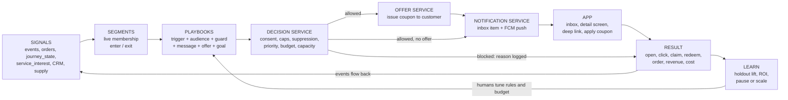
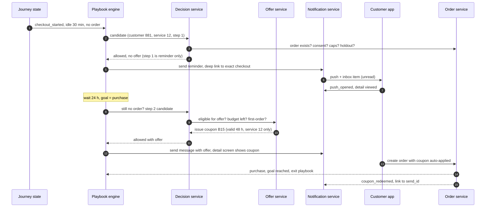
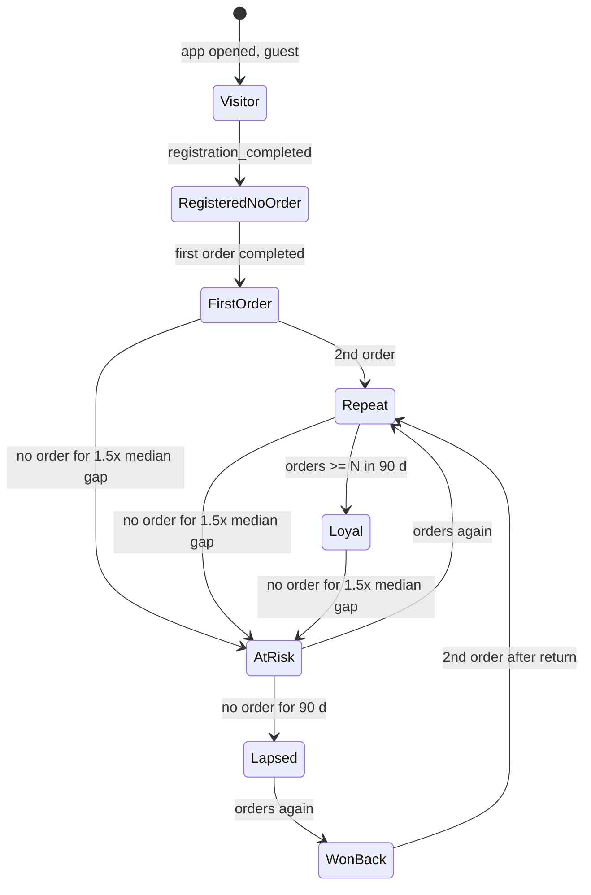
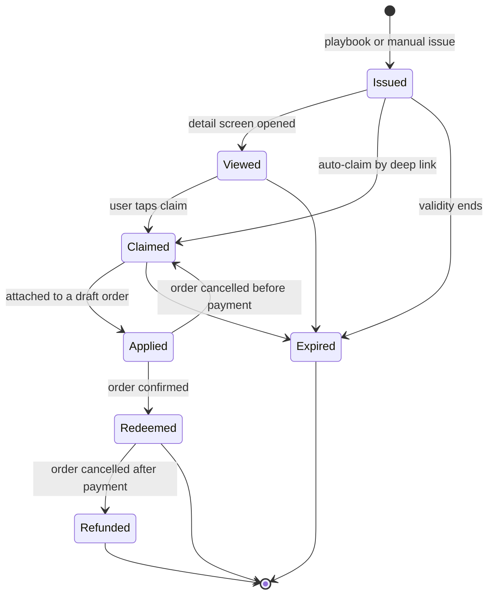
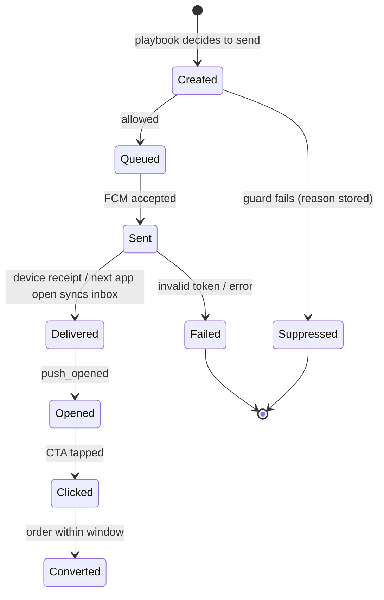
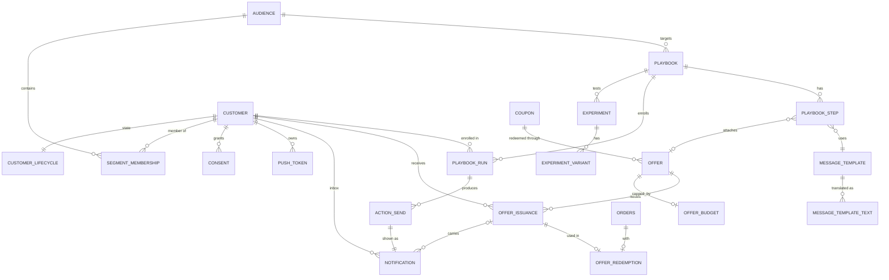

# bEasy Automation & Engagement — Segmentation, Notification, Offer & Performance Loop

**From insight → automatic action → offer → in-app notification detail → measured business result**

Companion to [bEasy-tracking-architecture-guide.md](bEasy-tracking-architecture-guide.md) (tracking, pipeline, DB, portal) and [Journey_Tracking.md](../requirements/Journey_Tracking.md) (functional spec). Those two answer *"what happened and who is the customer?"*. This guide answers *"what do we do about it automatically, with what offer, and did it make money?"*

> **Updated 8 Oct 2026 for UI v2.1** ([Journey_Tracking_UI_Flow_v2.1.md](../requirements/Journey_Tracking_UI_Flow_v2.1.md)). What changed here: (1) playbook triggers use the per-step **Abandoned** status, not a fixed idle time; (2) **manual recovery from a customer list** (bulk and single push) is the first live path and uses the same decision service; (3) **audience templates are hidden**, audiences start from a funnel list; (4) **CS inbox** replaces ad-hoc "CS task"; (5) guests are devices, with no push and no CS call; (6) the weekly marketing limit (3 shown) is shared by recovery pushes. Details in §17.

---

## Table of Contents

1. [Operating model and principles](#1-operating-model-and-principles)
2. [Platform components used](#2-platform-components-used)
3. [The automation loop](#3-the-automation-loop)
4. [Customer segmentation](#4-customer-segmentation)
5. [Playbooks (automation rules)](#5-playbooks-automation-rules)
6. [Offers: coupon and discount engine](#6-offers-coupon-and-discount-engine)
7. [Notification: inbox, detail screen, delivery](#7-notification-inbox-detail-screen-delivery)
8. [Guardrails: when NOT to send](#8-guardrails-when-not-to-send)
9. [Business performance tracking](#9-business-performance-tracking)
10. [Data model (3NF)](#10-data-model-3nf)
11. [Event dictionary](#11-event-dictionary)
12. [API endpoints](#12-api-endpoints)
13. [Portal screens](#13-portal-screens)
14. [Responsibility split](#14-responsibility-split)
15. [Rollout phases](#15-rollout-phases)
16. [Open decisions](#16-open-decisions)
17. [v2.1 changes (UI of 7 Oct 2026)](#17-v21-changes-ui-of-7-oct-2026)

---

## 1. Operating model and principles

Insight, decision and action form one loop. **Playbooks** watch segments and triggers and act on their own; people design, approve and monitor them.

| Layer | What it does | Who owns it |
|---|---|---|
| Signals | Events, orders, journey state, service interest, CRM, supply | Backend |
| Segments | Live audiences with enter / exit | Marketing defines, backend evaluates |
| Playbooks | Trigger + audience + guards + steps + offer + goal | Marketing / CMS design, Finance approves offers |
| Message | One message = push + persistent **inbox item** + **detail screen** + optional **offer** | Marketing / CMS content, backend delivers |
| Measurement | **Incremental revenue minus discount cost** per playbook, plus lifecycle, cohort and supply-demand health | Backend computes, portal displays |

Principle: **automate the routine, keep humans on policy.** People decide *rules, budgets, tone and offers*; the system decides *who, when and whether to send*.

Principles (numbering continues from §1 of the tracking guide):

8. **Backend decides, app renders.** Segment membership, eligibility, offer issuing and suppression are server-side. The app only shows an inbox item and executes a deep link.
9. **Every automated message has a goal, an exit condition and a measurement.** No goal → no send.
10. **Discount is the last lever, not the first.** Use information and reminders before price; escalate only after non-conversion.
11. **Measure incrementality, not activity.** Opens and clicks are diagnostics; the number that matters is orders that would not have happened without the message, net of discount cost.
12. **bEasy is two-sided.** Never create demand where no partner (cleaner) capacity exists.

---

## 2. Platform components used

The design builds on components that exist in the app and portal.

| Component | Where | Role in this design |
|---|---|---|
| Notification inbox and announcements with detail by id and coupon claim | `bEasy-app/lib/controller/announcement_controller.dart`, `view/screen/notification/announcement_list_screen.dart`, endpoint `customer/announcement` | Inbox list and detail screen; personal items added through `/customer/notifications`, with `notification_id` tracking and read / claim events |
| FCM handling (foreground, opened, local notifications), payload `type` + `value` | `util/firebase_messaging_service.dart`, `local_notifications_service.dart` | Push delivery; payload carries `notification_id`, `send_id`, `action_id`, `category`; `push_opened` logged |
| Topic subscription by profile | `helper/type_notification.dart` (`customer/notification/list/topics`) | Broadcast by user type / gender / age; behaviour segments use per-token, per-customer sends |
| Coupon with rules: `isNewUserOnly`, `minSpentAmount`, `maxRedeemCount`, `selectedProducts`, `targetUser`, expiry; claim by deep link (`customer/coupon/claim-deep-link`); apply v6 | `bEasy-portal/app/routes/coupon/*`, app `app_constants.dart` | Redeem mechanism behind offers; per-customer issuance, budget and cost layered on top |
| Portal push-notification create / schedule / detail; target users form | `bEasy-portal/app/routes/push-notification/*`, `components/common/target-users-form-v2.tsx` | One-off broadcasts; gains audience picker, holdout, goal and results |
| Popup banners with views / clicks / CTR analytics | portal `PopupBannerProps` types, app `promo_popup_policy.dart` | Third channel ("in-app") for the same playbooks |
| CRM customer cards, filters and saved presets | `bEasy-portal/app/components/customer-cards/*`, `lib/customer-filters.ts` | CRM half of the audience builder |

The first phase is mostly wiring: IDs in payloads, per-customer sends and measurement.

---

## 3. The automation loop



### 3.1 Two execution paths

| Path | Trigger source | Latency | Use for |
|---|---|---|---|
| **Real-time** | Backend events: booking draft / checkout API calls (`X-Journey-Id`), order status changes, registration | seconds to minutes | Checkout recovery, payment failed, order completed → review |
| **Batch** | Pipeline-built read models (`journey_state`, `service_interest`, lifecycle) evaluated every 15 min / daily | minutes to hours | Lifecycle, win-back, cross-sell, onboarding series, expiring coupons |

Both end in the same **Decision service**, so safety rules exist in one place. Real-time triggers use backend state (not BigQuery), consistent with §5.2 of the tracking guide.

### 3.2 Recovery example with escalation (the discount ladder)



---

## 4. Customer segmentation

A **segment** is a saved rule tree (the audience builder from §7 of the Journey spec) that is **evaluated continuously**, not only at send time. Membership has `entered_at` / `exited_at`, so "customer **entered** segment X" can be a trigger.

### 4.1 Segment sources

| Source | Examples | Backed by |
|---|---|---|
| **Lifecycle** (rule-based, mutually exclusive) | `visitor`, `registered_no_order`, `first_order_done`, `repeat`, `loyal`, `at_risk`, `lapsed`, `won_back` | `customer_lifecycle` (new, derived from orders) |
| **Value** (RFM, bucketed by rules) | recency days, order count, total spend, average order value → `high / mid / low` | `customer_value` (derived) |
| **Behaviour** | journey status, furthest step, repeat views, service interest level | `journey_state`, `service_interest` |
| **Service affinity** | last service completed, services ever booked, services viewed but never booked | orders + `service_interest` |
| **Geography** | `zone_id` of last address | order / address reference |
| **Acquisition** | source, campaign, first promo used | `attribution_touch` |
| **Preference** | language (km/en/zh), platform, app version, push opt-in | profile + `push_token` |
| **Supply context** | zone has spare capacity tomorrow | partner schedule (see §9.6) |
| **CRM** | saved CRM segments and filter presets | customer-cards segments, `customer-segment` presets |

### 4.2 Lifecycle definition (starting thresholds, configurable)



"At risk" uses the **median reorder gap per service** (e.g. home cleaning reorders every ~14–30 days), not one global number. This also drives the repeat-reminder timing in §5.

### 4.3 Who can be targeted (recipient)

The tracking guide targets `customer_id`. Two gaps to decide (§16):

- **Guests have an FCM token but no customer.** Registration-drop recovery (OTP verified, sign-up not completed) targets exactly those. Recommended: P1 customers only; P2 add `app_instance_id` as an alternative recipient with the inbox item merged into the customer on `identity_link`.
- **ABA Mini App users** (the mini-app webview) have no FCM token. They are reachable only through an in-mini-app inbox / banner, not push.

---

## 5. Playbooks (automation rules)

A **playbook** is the automation unit: *when X happens to someone in segment Y, if guards pass, send message Z (with offer W), until goal G or exit E.*

### 5.1 Anatomy

| Field | Meaning | Example |
|---|---|---|
| Trigger | event / segment entry / schedule | `checkout_started` + idle 45 min |
| Audience | segment rule tree (reuses audience builder) | registered, service 12, no order |
| Guards | extra checks at send time | order not created, not suppressed, capacity ok |
| Steps | ordered messages with waits | step 1 reminder → wait 24 h → step 2 with offer |
| Message | template + per-language text + deep link + detail content | see §7 |
| Offer | optional, per step | `B15` after step 1 failed |
| Goal | what success means | `purchase_completed` within 72 h |
| Exit | stop conditions | goal reached, order cancelled, opted out, cap hit |
| Holdout % | share who never receive it | 10% |
| Priority class | for conflicts (§8) | `recovery` |
| Budget | max discount spend / max redemptions | $300 / 40 uses |
| Owner + approval | maker-checker for offers above a threshold | Marketing → Finance |

### 5.2 Starter catalogue

Maps the situations in §9–§10 of the Journey spec to concrete playbooks. "Offer" starts at *none* wherever the spec says do not discount immediately.

| # | Playbook | Trigger | Guard | Step 1 | Step 2 | Goal |
|---|---|---|---|---|---|---|
| 1 | Checkout recovery | `checkout_started`, idle 30–60 min | no order, capacity ok | Reminder, deep link to checkout | +24 h: small offer, same service | purchase 72 h |
| 2 | Slot / details recovery | `slot_selected` or details done, idle 2 h | slot still available | "Your slot is waiting" | +24 h: reminder with next free slot | purchase 72 h |
| 3 | Booking started, no details | `booking_started`, idle 1 h | — | Continue booking | none (do not discount) | details done |
| 4 | Repeat viewers | service viewed ≥ 2 sessions in 7 d, no booking | — | Benefit / proof message | none | booking started |
| 5 | Registered, no order | `registration_completed`, D+1 / D+3 / D+7 | no order | D1 how it works; D3 service viewed most | D7 **first-order offer** | first order |
| 6 | Order completed → review | `service_completed` + 2 h | no open complaint | Ask for rating | — | review given |
| 7 | Repeat reminder | completed + service median gap − 3 d | no active journey for that service | "Time for your next clean" | — | rebook |
| 8 | Cross-sell | service A completed, viewed service B | — | Relevant service B info | optional small offer | booking B |
| 9 | Win-back | lifecycle enters `lapsed` | not suppressed | "We miss you" + service last used | +7 d: tiered offer | order |
| 10 | Cancelled order recovery | `order_cancelled` | reason known | **CS task**, no promo push | rebooking nudge +7 d | rebook |
| 11 | Coupon expiry | claimed coupon expires in 24 h, unused | — | Reminder | — | redeemed |
| 12 | Slot filler | zone/slot has spare partner capacity tomorrow | capacity data | Offer to segment in that zone | — | slot booked |
| 13 | Payment failed | payment failure event | — | Retry link (transactional class) | — | order paid |

### 5.3 Multi-step logic (P2)

P1 supports **linear steps with waits** and goal/exit checks before each step. Branching (if opened → X else → Y), A/B variants and per-customer best offer are P2/P3.

---

## 6. Offers: coupon and discount engine

The portal creates coupons and the app claims them by deep link. This layer adds **issuing to a specific customer automatically, within a budget, with cost tracked**.

### 6.1 Offer model

| Concept | Meaning |
|---|---|
| **Offer** | The deal definition: type (`percent`, `fixed`, `free_addon`), value, max discount cap, eligible `service_id`s, min spend, validity period or "N hours after issue", new-customer-only flag |
| **Offer budget** | Total spend and redemption cap, optional per playbook |
| **Issuance** | One offer given to one customer, with its own expiry and **unique code or entitlement** |
| **Redemption** | An order that used an issuance; links to the order and records the **actual discount cost** |

Reuse the existing coupon table as the *redeem mechanism* (`applyCouponV6`); the new layer **issues** coupons to customers and tracks cost. Per-customer issuance should create a customer-bound entitlement so a code leaked in a group chat does not become public.

### 6.2 Discount ladder (default policy)

```text
Level 0  Information / reminder only            ← default for most playbooks
Level 1  Convenience (priority slot, free add-on, small fixed amount)
Level 2  Percent or fixed discount, capped
Level 3  Tiered win-back (larger, only for lapsed, only with budget)
```

Rules:
- Escalate **one level at a time, only after the previous step failed**.
- Never offer to customers who have a pending/created order for that service.
- Prefer **fixed amount with min spend** over percent on high-value services (protects margin).
- The same customer cannot receive more than one *active* acquisition-type offer at once.
- Seen-and-ignored offers still count against frequency caps.

### 6.3 Abuse and leakage controls

| Risk | Control |
|---|---|
| Account farming for first-order offers | One first-order offer per phone **and** per device (`app_instance_id` via `identity_link`); delay issuance until OTP verified |
| Shared codes | Customer-bound issuance, `max_redeem_per_customer = 1` |
| Giving discount to people who would buy anyway | Holdout group + elasticity rules (offer only after step 1 failed, never at checkout step if no price hesitation signal) |
| Training users to wait for coupons | Cap offers per customer per 30/90 d; vary timing |
| Budget overrun | Auto-pause playbook at 80% / 100% of budget; alert |
| Margin erosion | Margin floor per service; Decision service rejects offers that break it |
| Tracking invalid code attempts | `promo_applied` with `promo_result=invalid` repeated ≥ 3 → fraud signal / "promo hunter" segment |

### 6.4 Coupon lifecycle



---

## 7. Notification: inbox, detail screen, delivery

One **message** is delivered through up to three channels, but is always stored in the **inbox** so it survives a dismissed push, disabled notifications, or a missed delivery.

| Channel | Use | Notes |
|---|---|---|
| **Push (FCM)** | Attention | Subject to consent, quiet hours, caps. Payload carries IDs, not content |
| **Inbox item** | Persistent record + detail screen | Always created, even when push is suppressed (except hard opt-out of marketing) |
| **In-app popup / banner** | When user opens the app | Reuse existing popup banner system |
| SMS / Telegram *(optional later)* | Push-disabled high-value cases | Cost per message; separate decision |

### 7.1 Message content (server-defined, localized)

```json
{
  "notification_id": "n_01HX...",
  "type": "offer",
  "title":   {"km": "...", "en": "Your cleaning slot is waiting", "zh": "..."},
  "body":    {"km": "...", "en": "Finish your booking and save $3", "zh": "..."},
  "image_url": "https://.../cleaning.jpg",
  "cta": {"label": {"en": "Continue booking"}, "deeplink": "beasy://service/12?journey=resume&notification_id=n_01HX"},
  "offer": {"issuance_id": 5521, "code": "B15-8F2K", "text": {"en": "$3 off"}, "expires_at": "2026-10-03T14:00:00+07:00", "terms": ["Service 12 only", "Min spend $20"]},
  "expires_at": "2026-10-03T14:00:00+07:00",
  "send_id": 99120,
  "action_id": 77
}
```

### 7.2 Push payload (small, ID-based)

Keeps the `type` / `value` keys for installed app versions and adds the IDs below.

```json
{
  "type": "notification_detail",
  "value": "n_01HX...",
  "notification_id": "n_01HX...",
  "send_id": "99120",
  "action_id": "77",
  "category": "recovery"
}
```

The app opens the **detail screen by `notification_id`** and fetches the content from the backend. This way content, offer status (still valid? already used?) and localization are always current, and nothing sensitive sits in the push.

### 7.3 Notification detail screen

```text
┌──────────────────────────────────┐
│ ←  Notification                  │
├──────────────────────────────────┤
│  [ Hero image ]                  │
│  Your cleaning slot is waiting   │  title
│  Finish your booking and save $3 │  body
│                                  │
│  ┌────────────────────────────┐  │
│  │ $3 OFF  · Code B15-8F2K    │  │  offer card (only if offer)
│  │ Valid until 3 Oct, 2:00 PM │  │  countdown when < 24 h
│  │ Service 12 · Min spend $20 │  │
│  │ [ Claim ]   (or "Applied") │  │
│  └────────────────────────────┘  │
│                                  │
│  Terms (expandable)              │
│                                  │
│  [ Continue booking ]            │  primary CTA → deep link
└──────────────────────────────────┘
```

State handling (server returns `state`; app renders it, never guesses):

| State | Screen |
|---|---|
| `active` | Normal, CTA enabled |
| `offer_claimed` | Card shows "Claimed", CTA applies it automatically |
| `offer_redeemed` | "Used on order #…", CTA becomes "Book again" |
| `expired` | Greyed card, CTA goes to the service without offer |
| `order_exists` | "Your booking is confirmed", CTA → order detail (this is why detail is fetched live) |

Inbox list: unread dot, type icon, grouped by date, swipe to delete (soft delete), pull to refresh, badge on the bell. Mark read on detail open.

### 7.4 Deep link rules

- Resolve to the **exact service / booking draft** (`journey=resume` restores selections where the draft exists); never fall back to Home for high-intent users.
- Apply the offer **only after** the user has an eligible cart; show clear failure text if not eligible (e.g. min spend).
- Works in all three app states (foreground, background, terminated — terminated-state taps need `getInitialMessage` handling in `firebase_messaging_service.dart`).
- Unauthenticated tap → login first, then continue to the original target.

### 7.5 Delivery status



FCM does not guarantee a per-device receipt on iOS. Treat **inbox sync on next app open** as the reliable "delivered" signal and `push_opened` as the reliable engagement signal.

---

## 8. Guardrails: when NOT to send

All checks live in the **Decision service** and run immediately before every send (not only when the playbook was designed). The result is always stored (`sent` or a `suppression_reason`).

| Check | Rule |
|---|---|
| Order state | Order exists for that service/journey → cancel step, exit playbook |
| Consent | Push permission granted **and** category allowed (transactional / recovery / promotional / lifecycle) |
| Token health | Valid token, not marked invalid after FCM errors |
| Frequency caps | Per customer: max per day and per week **across all playbooks**; per playbook cooldown (e.g. same playbook not within 7 d) |
| Quiet hours | No push 21:00–08:00 `Asia/Phnom_Penh`; inbox item still created; sends deferred to the next window |
| Priority | When several playbooks qualify, send one: `transactional > recovery > lifecycle > promotional`; others are deferred, not dropped |
| Holdout | Reserve the control group first (per playbook plus a **global 3–5% control that receives no automated promos**) |
| Budget | Offer budget / redemption cap not reached; margin floor respected |
| Capacity | For demand-creating sends, partner capacity exists for the zone/slot (§9.6) |
| Negative signals | Open complaint, recent cancellation, opt-out spike → hold promotional messages |
| Suppression list | Manually suppressed, test accounts, staff |
| Language | Use customer's language; fall back to `km` |

Governance:
- **Kill switch** per playbook and global.
- **Dry run / simulate** before activation: shows who would have been messaged in the last 7 days and the expected cost.
- **Approval** (maker-checker) for any playbook with an offer above a threshold or an audience above N customers.
- **Audit log** of who changed a rule, offer or budget.
- **Test send** to staff devices with the real template and a real inbox item.
- RBAC reuses the portal's existing roles (`marketing`, `cms`, `admin`); add `finance` view for offer cost.

---

## 9. Business performance tracking

The tracking guide measures *funnel health*. This section adds *business health* — four lenses.

### 9.1 Lens A — Automation effectiveness (per playbook / message)

| Metric | Definition | Why |
|---|---|---|
| Eligible → sent rate | sent ÷ candidates | Shows how much the guards block, and why |
| Delivery / open / CTA rate | from `action_send` + events | Diagnostics only |
| Claim and redemption rate | claimed ÷ issued; redeemed ÷ claimed | Offer attractiveness |
| **Conversion lift** | conv(treated) − conv(holdout) | Did it *cause* orders? |
| **Incremental orders** | lift × treated customers | |
| **Incremental revenue** | incremental orders × average order value | |
| **Discount cost** | Σ discount on redeemed orders | |
| **Net incremental margin** | incremental revenue × margin − discount cost − send cost | The decision metric |
| **Cost per incremental order** | discount cost ÷ incremental orders | Compare playbooks; set a ceiling |
| Time to convert | send → order | Tunes wait times |

### 9.2 Lens B — Customer lifecycle & value

| Metric | Use |
|---|---|
| Lifecycle mix over time | How many visitors / registered-no-order / repeat / at-risk / lapsed; the funnel *between* orders |
| Activation rate | registered → first order within 7 / 30 d |
| Repeat rate and median reorder gap **per service** | Sets reminder timing and "at risk" thresholds |
| **Cohort retention** | Customers grouped by first-order month → % ordering again in month 1, 2, 3… |
| **LTV by acquisition source / first service / first offer** | Which channel and which first offer produce valuable customers, not just first orders |
| Win-back rate | lapsed → ordered again after a playbook |
| Cancellation and complaint rate by cohort | Quality signal, also a guardrail |

### 9.3 Lens C — Offer economics

| Metric | Use |
|---|---|
| Spend vs budget per offer / playbook | Auto-pause trigger |
| Discount as % of GMV | Margin protection |
| **Offer dependency** | Share of a customer's orders that used an offer; high → conditioned to wait |
| First-order offer vs organic first-order LTV | Is the subsidy paying back? |
| Payback period | Days until a cohort's margin covers its discount + acquisition cost |
| Abuse flags | Same device/phone multiple first-order claims, invalid-code storms |

### 9.4 Lens D — Acquisition → money

Extends `/attribution/campaigns`:

`spend (manual or imported)` → installs → registrations → first orders → **CAC**, **cost per registration**, **ROAS**, **D30 repeat rate**, **LTV/CAC**.

Ad spend is not in the system; start with a simple manual or CSV spend entry per campaign per day, import from Meta / Google later.

### 9.5 Attribution rule (one precedence, written down)

Avoid double-counting when a customer touches several messages:

1. **Coupon redemption** → credited to the issuing send (deterministic).
2. Otherwise **last `push_opened` / `notification_detail_viewed` within 24 h before the order** (same service if available).
3. Otherwise no automation credit (organic).
4. Revenue **lift** is always computed against the holdout, so attribution only decides *which playbook gets the display credit*, not whether the effect is real.

Windows (configurable): push 24 h, inbox/detail 48 h, offer validity period for redemptions.

### 9.6 Supply–demand lens (specific to a two-sided marketplace)

Marketing that fills the funnel but cannot be fulfilled creates cancellations and bad reviews.

| Signal | Source | Use |
|---|---|---|
| Open slots vs bookings per zone / service / day | partner schedule, blocked-schedule, orders | **Slot-filler playbook** (#12) targets low-utilisation windows |
| Orders cancelled for "no partner assigned" | order cancellation reason | Guard: pause demand-creating playbooks in affected zones |
| Time to assign a partner | assigning flow | Quality guardrail on promo-driven orders |
| Partner utilisation / idle hours | partner data | Pairs with partner-side incentives (separate product) |

Guard rule: promotional sends for a zone/slot are blocked when projected capacity < demand threshold. Weekly view: **demand pushed vs capacity available** per zone.

### 9.7 Dashboards

| Dashboard | Primary question | Audience |
|---|---|---|
| **Automation overview** | Which playbooks make money net of cost? | Marketing |
| **Offer economics** | Are we over- or under-spending? Who is abusing? | Marketing + Finance |
| **Lifecycle & cohorts** | Are customers staying? Which source gives the best LTV? | Management |
| **Supply–demand** | Can we serve what we promote? | Ops |
| **Message health** | Opt-outs, push disabled, token failures, caps hit | Marketing + Tech |
| Existing: Acquisition / Registration / Booking funnels | Where do people drop? | Marketing, Product |

### 9.8 Weekly decision rhythm

The point of tracking is a routine, not a dashboard:

| Cadence | Who | Looks at | Decides |
|---|---|---|---|
| Daily (5 min) | Marketing | Message health, budget burn, blocked sends | Pause / fix |
| Weekly | Marketing + Ops | Playbook net margin, supply–demand, top drop-off | Scale, tune, retire playbooks; adjust budgets |
| Monthly | Management | Cohorts, LTV/CAC, offer dependency | Pricing, acquisition mix, new playbooks |

### 9.9 Experimentation (P2)

- A/B on message copy, timing, offer level; randomization by customer hash; holdout is the control for the playbook.
- Minimum sample and run time shown in portal; do not call winners early.
- Winner promotes to default; losers are archived with results (keep a "what we learned" log).

---

## 10. Data model (3NF)

Naming and style match §6 of the tracking guide. Tables referenced from it: `customer`, `orders`, `service`, `campaign`, `audience` (with `is_dynamic`), `marketing_action`, `action_send` (with `run_id`, `step_id`, `variant_id`, `clicked_at`), `channel`, `suppression_reason`, and the coupon table (shown as `coupon`).

### 10.1 ER overview



### 10.2 DDL: segments and lifecycle

```sql
-- live membership of dynamic audiences (audience.is_dynamic = true, tracking guide §6.7)
CREATE TABLE segment_membership (
  audience_id bigint NOT NULL REFERENCES audience(audience_id),
  customer_id bigint NOT NULL REFERENCES customer(customer_id),
  entered_at  timestamptz NOT NULL,
  exited_at   timestamptz,
  PRIMARY KEY (audience_id, customer_id, entered_at)
);
CREATE INDEX ix_segmem_open ON segment_membership (audience_id) WHERE exited_at IS NULL;

CREATE TABLE lifecycle_stage (
  stage_id smallint PRIMARY KEY,
  code     text NOT NULL UNIQUE      -- visitor, registered_no_order, first_order, repeat, loyal, at_risk, lapsed, won_back
);

-- derived, rebuildable (read model like journey_state)
CREATE TABLE customer_lifecycle (
  customer_id     bigint PRIMARY KEY REFERENCES customer(customer_id),
  stage_id        smallint NOT NULL REFERENCES lifecycle_stage(stage_id),
  stage_since     timestamptz NOT NULL,
  orders_count    integer NOT NULL,
  total_spend     numeric(12,2) NOT NULL,
  last_order_at   timestamptz,
  zone_id         integer,
  language_code   char(2),
  computed_at     timestamptz NOT NULL DEFAULT now()
);
```

### 10.3 DDL: consent, tokens

```sql
CREATE TABLE push_token (
  token_id        bigserial PRIMARY KEY,
  app_instance_id text NOT NULL REFERENCES app_instance(app_instance_id),
  fcm_token       text NOT NULL UNIQUE,
  permission      text NOT NULL CHECK (permission IN ('granted','denied','not_asked')),
  is_valid        boolean NOT NULL DEFAULT true,   -- false after FCM "unregistered"
  updated_at      timestamptz NOT NULL
);
-- customer reaches a token through identity_link (linked_at / unlinked_at), no duplicate customer_id here

CREATE TABLE message_category (
  category_id smallint PRIMARY KEY,
  code        text NOT NULL UNIQUE,   -- transactional, recovery, lifecycle, promotional
  priority    smallint NOT NULL UNIQUE
);

CREATE TABLE consent (
  customer_id bigint   NOT NULL REFERENCES customer(customer_id),
  category_id smallint NOT NULL REFERENCES message_category(category_id),
  channel_id  smallint NOT NULL REFERENCES channel(channel_id),
  is_allowed  boolean  NOT NULL,
  updated_at  timestamptz NOT NULL,
  PRIMARY KEY (customer_id, category_id, channel_id)
);
```

### 10.4 DDL: message, offer, playbook

```sql
CREATE TABLE message_template (
  template_id  integer PRIMARY KEY,
  code         text NOT NULL UNIQUE,
  category_id  smallint NOT NULL REFERENCES message_category(category_id),
  type         text NOT NULL CHECK (type IN ('info','offer','reminder','transactional')),
  image_url    text,
  deeplink_tpl text NOT NULL,                       -- e.g. beasy://service/{service_id}?journey=resume
  is_active    boolean NOT NULL DEFAULT true
);

CREATE TABLE message_template_text (
  template_id   integer NOT NULL REFERENCES message_template(template_id),
  language_code char(2) NOT NULL,                   -- km, en, zh
  title         text NOT NULL,
  body          text NOT NULL,
  cta_label     text,
  PRIMARY KEY (template_id, language_code)
);

CREATE TABLE offer (
  offer_id          integer PRIMARY KEY,
  coupon_id         bigint  NOT NULL REFERENCES coupon(id),   -- existing redeem mechanism
  name              text    NOT NULL,
  level             smallint NOT NULL CHECK (level BETWEEN 1 AND 3),  -- discount ladder
  valid_hours_after_issue integer NOT NULL,
  max_per_customer  smallint NOT NULL DEFAULT 1,
  is_active         boolean NOT NULL DEFAULT true
);

CREATE TABLE offer_budget (
  offer_id          integer PRIMARY KEY REFERENCES offer(offer_id),
  max_spend         numeric(12,2),
  max_redemptions   integer,
  spent             numeric(12,2) NOT NULL DEFAULT 0,
  redeemed          integer       NOT NULL DEFAULT 0
);

CREATE TABLE playbook (
  playbook_id    integer PRIMARY KEY,
  name           text NOT NULL,
  audience_id    bigint REFERENCES audience(audience_id),
  category_id    smallint NOT NULL REFERENCES message_category(category_id),
  trigger_type   text NOT NULL CHECK (trigger_type IN ('event','segment_entry','schedule')),
  trigger_event_type_id smallint REFERENCES event_type(event_type_id),
  trigger_idle_minutes  integer,
  goal_event_type_id    smallint NOT NULL REFERENCES event_type(event_type_id),
  goal_window_hours     integer  NOT NULL,
  holdout_pct    numeric(5,2) NOT NULL DEFAULT 10,
  status         text NOT NULL CHECK (status IN ('draft','pending_approval','active','paused','archived')),
  approved_by    bigint,
  created_by     bigint NOT NULL,
  created_at     timestamptz NOT NULL DEFAULT now()
);

CREATE TABLE playbook_step (
  step_id      integer PRIMARY KEY,
  playbook_id  integer NOT NULL REFERENCES playbook(playbook_id),
  step_no      smallint NOT NULL,
  wait_minutes integer  NOT NULL DEFAULT 0,        -- after previous step
  template_id  integer  NOT NULL REFERENCES message_template(template_id),
  offer_id     integer  REFERENCES offer(offer_id),
  UNIQUE (playbook_id, step_no)
);

-- one customer's pass through a playbook (+ the journey/service that triggered it)
CREATE TABLE playbook_run (
  run_id       bigserial PRIMARY KEY,
  playbook_id  integer NOT NULL REFERENCES playbook(playbook_id),
  customer_id  bigint  NOT NULL REFERENCES customer(customer_id),
  journey_id   uuid    REFERENCES journey(journey_id),
  is_holdout   boolean NOT NULL DEFAULT false,
  status       text    NOT NULL CHECK (status IN ('active','goal_reached','exited','expired')),
  exit_reason  text,
  started_at   timestamptz NOT NULL,
  ended_at     timestamptz
);
CREATE INDEX ix_run_customer ON playbook_run (customer_id, started_at);
```

### 10.5 DDL: sends, inbox, issuance, redemption

```sql
-- action_send columns are defined in tracking guide §6.7; foreign keys complete here once the targets exist
ALTER TABLE action_send ADD CONSTRAINT fk_send_run  FOREIGN KEY (run_id)  REFERENCES playbook_run(run_id);
ALTER TABLE action_send ADD CONSTRAINT fk_send_step FOREIGN KEY (step_id) REFERENCES playbook_step(step_id);

CREATE TABLE offer_issuance (
  issuance_id  bigserial PRIMARY KEY,
  offer_id     integer NOT NULL REFERENCES offer(offer_id),
  customer_id  bigint  NOT NULL REFERENCES customer(customer_id),
  code         text    NOT NULL UNIQUE,                 -- customer-bound
  issued_at    timestamptz NOT NULL,
  expires_at   timestamptz NOT NULL,
  claimed_at   timestamptz,
  UNIQUE (offer_id, customer_id, issued_at)
);

CREATE TABLE notification (                              -- the inbox item
  notification_id uuid PRIMARY KEY,
  send_id         bigint  NOT NULL UNIQUE REFERENCES action_send(send_id),
  customer_id     bigint  NOT NULL REFERENCES customer(customer_id),
  template_id     integer NOT NULL REFERENCES message_template(template_id),
  issuance_id     bigint  REFERENCES offer_issuance(issuance_id),
  service_id      integer REFERENCES service(service_id),
  created_at      timestamptz NOT NULL,
  expires_at      timestamptz,
  read_at         timestamptz,
  deleted_at      timestamptz
);
CREATE INDEX ix_notif_inbox ON notification (customer_id, created_at DESC) WHERE deleted_at IS NULL;

CREATE TABLE offer_redemption (
  issuance_id    bigint PRIMARY KEY REFERENCES offer_issuance(issuance_id),
  order_id       bigint NOT NULL UNIQUE REFERENCES orders(order_id),
  discount_amount numeric(12,2) NOT NULL,              -- actual cost
  redeemed_at    timestamptz NOT NULL,
  refunded_at    timestamptz
);
```

Notes:
- Message text lives only in `message_template_text` (3NF); the rendered text is not copied into `notification`. If copy must be frozen for audit, store a `template_version` instead of text.
- A notification's status (sent / delivered / opened / clicked) is **not duplicated**: it comes from `action_send` timestamps.
- Conversion per playbook is still a **view** (sent vs holdout, joined to orders in the attribution window), as in §6.7.

### 10.6 DDL: read models for performance

```sql
CREATE TABLE mart_playbook_daily (
  stat_date    date    NOT NULL,
  playbook_id  integer NOT NULL REFERENCES playbook(playbook_id),
  step_no      smallint NOT NULL,
  candidates   integer NOT NULL,
  suppressed   integer NOT NULL,
  sent         integer NOT NULL,
  opened       integer NOT NULL,
  clicked      integer NOT NULL,
  holdout_n    integer NOT NULL,
  treated_orders  integer NOT NULL,
  holdout_orders  integer NOT NULL,
  revenue      numeric(12,2) NOT NULL,
  discount_cost numeric(12,2) NOT NULL,
  PRIMARY KEY (stat_date, playbook_id, step_no)
);

CREATE TABLE mart_cohort_monthly (
  cohort_month   date     NOT NULL,        -- month of first order
  source_id      smallint REFERENCES traffic_source(source_id),
  first_service_id integer REFERENCES service(service_id),
  months_since   smallint NOT NULL,
  customers      integer  NOT NULL,        -- cohort size
  active_customers integer NOT NULL,
  orders         integer  NOT NULL,
  revenue        numeric(12,2) NOT NULL,
  discount_cost  numeric(12,2) NOT NULL,
  PRIMARY KEY (cohort_month, source_id, first_service_id, months_since)
);

CREATE TABLE mart_zone_capacity_daily (
  stat_date   date    NOT NULL,
  zone_id     integer NOT NULL,
  service_id  integer NOT NULL REFERENCES service(service_id),
  open_slots  integer NOT NULL,
  booked      integer NOT NULL,
  cancelled_no_partner integer NOT NULL,
  PRIMARY KEY (stat_date, zone_id, service_id)
);
```

Marketing spend (for CAC / ROAS):

```sql
CREATE TABLE campaign_spend (
  campaign_id integer NOT NULL REFERENCES campaign(campaign_id),
  spend_date  date    NOT NULL,
  amount      numeric(12,2) NOT NULL,
  currency_code char(3) NOT NULL,
  PRIMARY KEY (campaign_id, spend_date)
);
```

### 10.7 Experiments (P2)

```sql
CREATE TABLE experiment (
  experiment_id integer PRIMARY KEY,
  playbook_id   integer NOT NULL REFERENCES playbook(playbook_id),
  step_no       smallint NOT NULL,
  metric        text NOT NULL,
  status        text NOT NULL CHECK (status IN ('draft','running','done'))
);
CREATE TABLE experiment_variant (
  variant_id    integer PRIMARY KEY,
  experiment_id integer NOT NULL REFERENCES experiment(experiment_id),
  name          text NOT NULL,
  template_id   integer REFERENCES message_template(template_id),
  offer_id      integer REFERENCES offer(offer_id),
  weight        numeric(5,2) NOT NULL
);
ALTER TABLE action_send ADD CONSTRAINT fk_send_variant FOREIGN KEY (variant_id) REFERENCES experiment_variant(variant_id);
```

---

## 11. Event dictionary

Append to the event dictionary in §4.4 of the tracking guide. Same wrapper, same common params (`event_id`, `schema_version`, `seq`).

| Event | Owner | Extra params | Purpose |
|---|---|---|---|
| `push_permission_viewed` | Client | `context` (`pre_prompt`/`system`) | Opt-in funnel |
| `push_permission_result` | Client | `result` (`granted`/`denied`) | Opt-in rate; decides channel reach |
| `push_opened` *(exists)* | Client | + `notification_id`, `category` | Engagement + attribution |
| `notification_inbox_viewed` | Client | `unread_count` | Inbox usage |
| `notification_detail_viewed` | Client | `notification_id`, `send_id`, `source` (`push`/`inbox`/`popup`) | Detail reach |
| `notification_cta_clicked` | Client | `notification_id`, `send_id`, `cta` | Click-through |
| `offer_viewed` | Client | `issuance_id`, `notification_id` | Offer exposure |
| `offer_claimed` | Client + Backend | `issuance_id` | Claim (backend is the record) |
| `promo_applied` *(exists)* | Client | + `issuance_id`, `source` (`notification`/`manual`/`deeplink`) | Offer usage in checkout |
| `notification_deleted` | Client | `notification_id` | Negative signal |
| `notification_sent` | **Backend** | `send_id`, `action_id`, `playbook_id`, `step_no` | Send ledger as event |
| `notification_suppressed` | **Backend** | `send_id`, `reason` | Why not sent |
| `offer_issued` | **Backend** | `issuance_id`, `offer_id` | Cost exposure |
| `offer_redeemed` | **Backend** | `issuance_id`, `order_id`, `discount_amount` | Deterministic attribution + cost |
| `offer_expired` | **Backend** | `issuance_id` | Unused offer |
| `customer_lifecycle_changed` | **Backend** | `from_stage`, `to_stage` | Segment-entry triggers |
| `notification_settings_changed` | Client | `category`, `allowed` | Consent audit |

Header addition: send `X-Notification-Id` on create-order (and booking draft) when the flow started from a notification, so the backend can tie the order to the message without relying on the 24 h window.

---

## 12. API endpoints

Base `/api/v1` for portal; the customer app keeps its `/customer/...` surface (`customer/announcement`, `customer/coupon/...`).

### 12.1 Customer app

| Method | Path | Purpose |
|---|---|---|
| GET | `/customer/notifications?cursor=` | Inbox list (cursor paged; unread count in response) |
| GET | `/customer/notifications/{id}` | Detail with live `state`, offer card and deep link |
| POST | `/customer/notifications/{id}/read` | Mark read |
| DELETE | `/customer/notifications/{id}` | Soft delete |
| POST | `/customer/offers/{issuance_id}/claim` | Claim offer (idempotent) |
| GET | `/customer/offers` | "My offers" wallet: active, used, expired |
| PUT | `/customer/push-token` | Register/refresh token + permission state (with `X-App-Instance-Id`) |
| GET / PUT | `/customer/notification-settings` | Category consent |

Personal items come from `/customer/notifications`; non-personal announcements and topic broadcast stay on `customer/announcement`. The inbox screen shows both (notifications and announcements tabs).

### 12.2 Portal

| Method | Path | Purpose |
|---|---|---|
| GET/POST/PUT | `/segments` (alias of dynamic audiences) | Dynamic segments; `GET /segments/{id}/members`, `/segments/{id}/trend` |
| GET/POST/PUT | `/playbooks` | CRUD; `POST /playbooks/{id}/simulate` (dry run), `/submit`, `/approve`, `/activate`, `/pause` |
| GET | `/playbooks/{id}/runs` | Who was enrolled, step, outcome, suppression reason |
| GET/POST/PUT | `/message-templates` | Multi-language templates with preview |
| POST | `/message-templates/{id}/test-send` | Send to staff devices |
| GET/POST/PUT | `/offers`, `/offers/{id}/budget` | Offer definitions and budgets |
| GET | `/offers/{id}/issuances` | Issued / claimed / redeemed list |
| GET | `/performance/playbooks` | Table: sent, lift, incremental revenue, cost, net margin |
| GET | `/performance/playbooks/{id}` | Per step, trend, holdout comparison |
| GET | `/performance/offers` | Spend vs budget, dependency, abuse flags |
| GET | `/performance/lifecycle` | Stage mix and transitions |
| GET | `/performance/cohorts` | Retention / LTV by cohort month, source, first service |
| GET | `/performance/supply-demand` | Capacity vs demand pushed per zone |
| GET | `/performance/message-health` | Opt-outs, token failures, caps hit, blocks by reason |
| GET/POST | `/experiments` | P2 |
| POST | `/automation/kill-switch` | Global pause (admin only) |

Common filters match §7.1 of the tracking guide, plus `playbook_id`, `category`, `lifecycle_stage`, `zone_id`.

Internal workers: `segment.evaluate`, `playbook.tick` (due waits / triggers), `decision.check`, `offer.issue`, `notification.dispatch` (FCM), `lifecycle.build`, `cohort.build`, `budget.guard`.

---

## 13. Portal screens

Placement follows the portal's `routes.ts` and `nav-config.ts`. Build list and UX principles: `bEasy-portal/TODO.md`. Build scope per route is in section 2.1d of the tracking guide.

| Route | Content | Built on |
|---|---|---|
| `/playbooks` | List with status, audience size, net margin, budget burn, kill switch; builder: trigger → audience → guards → steps → goal → holdout and budget → simulate → submit for approval | Generalises `/push-notification` schedule types `EVENT_TRIGGERED` / `RECURRING` (trigger base `REGISTRATION` / `LAST_BOOKING`) |
| `/message-templates` | km / en / zh text, image, deep link, offer card, **phone preview of the detail screen**, test send | Multi-language inputs and banner uploads of the push form |
| `/coupon` | Offer rules, ladder level, budget, issuance table, abuse flags | Coupon create and usage pages |
| `/audiences` | Live size and trend, behaviour + CRM rule builder with estimate, members preview, dynamic vs snapshot, "used by" | Customer filter sheet and `customer-segment` presets |
| `/push-notification` | Audience picker, holdout, goal, offer, results vs holdout on the detail page | Existing push create / schedule / detail |
| `/automation` | Playbook table: lift, incremental revenue, discount cost, **net margin**; offer economics; message health | Popup-banner analytics layout (KPI tiles, table, detail sheet) |
| `/funnels`, `/attribution`, `/cohorts`, `/lifecycle`, `/supply-demand` | Business performance lenses (§9), in a new Analytics sidebar group | `/attribution` builds on the campaign report table |
| `/customer`, `/customer/:id/journey` | Lifecycle stage, interest per service, last messages and outcomes, active offers, suppress marketing | Customer list, card view and journey page |
| `/data-health` | Freshness, quarantine, DQ checks, pipeline runs | — |

## 14. Responsibility split

| Concern | App | Backend | Portal |
|---|---|---|---|
| Register token, report permission | **Owns** | Stores, validates | Shows opt-in rate |
| Inbox list, detail screen, offer card UI | **Owns** (renders `state`) | Returns state, content | — |
| Deep link routing, resume draft, apply coupon | **Owns** | Validates eligibility | — |
| Log notification / offer events | **Owns** | Records backend events | — |
| Segment evaluation, lifecycle, triggers | — | **Owns** | Defines rules |
| Guards, caps, consent, priority, budget | — | **Owns** | Configures thresholds |
| Offer issuance, redemption, cost | Applies coupon | **Owns** | Defines offers, views cost |
| Template content, playbook design | — | Stores | **Owns** (Marketing/CMS) |
| Approvals, kill switch, audit | — | Enforces | **Owns** |
| Measurement, lift, ROI, cohorts | — | **Owns** | Displays |

Rule of thumb extension: **the app never decides whether a customer deserves an offer; it only shows what the backend says is valid right now.**

---

## 15. Rollout phases

Same phases as §10 of the tracking guide, with the detail below.

| Phase | Client | Backend | Portal | Outcome |
|---|---|---|---|---|
| **P0 – Foundation** | Wrapper, IDs, headers | Event pipeline, journeys, identity | Funnels, event log | Trustworthy data |
| **P1a – Targeted send + measure** | Add `notification_id`/`send_id` to payload, `getInitialMessage` handling, `push_opened`, detail/CTA events, token + permission upload | Per-customer send via `action_send`, global + per-playbook holdout, caps, consent, suppression, send ledger, `notification` inbox item, results vs holdout | Behaviour audience in the push form; results page | Manual but measurable, targeted by behaviour |
| **P1b – First automations** | Notification detail with offer card, "My offers", claim | Playbooks (single trigger, 1–2 steps), `customer_lifecycle`, offer issuance + budget + redemption, decision service | Playbook builder, template editor, offer & budget, simulate/approve | #1 checkout recovery, #5 onboarding, #6 review, #11 coupon expiry run themselves |
| **P1c – Business performance** | — | `mart_playbook_daily`, cohort mart, spend import, attribution rule | Automation, Offer economics, Lifecycle & cohorts, Message health | Net-margin view per playbook |
| **P2 – Scale & optimise** | Notification settings screen, guest inbox | Multi-step branching, A/B experiments, supply-aware playbooks (#12), repeat reminders by service gap, guest recipients, abuse detection | Experiment views, supply–demand dashboard | Smarter, capacity-aware |
| **P3 – Predict** | — | Propensity / churn model, best-time-to-send, next-best-offer, uplift model, bandit offer selection | Model performance | Move from rules to learned policy using real conversion data |

**Order inside P1a/P1b:** payload IDs + events → send ledger + holdout + caps → inbox item + detail API → detail screen → offer issuance + budget → one playbook (#1) live to 10% → validate lift → add playbooks one at a time.

**Launch discipline:** each new playbook starts at 10% of its audience, with a holdout, a budget cap and a 14-day review date; promote or retire by net margin.

---

## 16. Open decisions

| # | Decision | Recommendation |
|---|---|---|
| 1 | Guests as recipients (registration-drop recovery needs them) | Customers only in P1; guests via `app_instance_id` in P2 |
| 2 | Per-customer coupon: extend the existing coupon table or new entitlement table | New `offer_issuance` bound to a coupon row; keep `applyCouponV6` for redemption |
| 3 | Where to deliver "delivered" status | Inbox sync on next open as the reliable signal; FCM receipts as a bonus |
| 4 | Quiet hours and caps | 21:00–08:00 Phnom Penh; 1 promo/day, 3/week as a start, review after 4 weeks |
| 5 | Margin per service for the margin floor | Finance to provide; until then, cap by discount % of GMV |
| 6 | Ad spend source | Manual/CSV first, API import later |
| 7 | SMS / Telegram fallback for push-disabled customers | Decide after seeing opt-in rate from `push_permission_result` |
| 8 | Mini App (ABA) messaging | In-mini-app inbox/banner only; no push channel |
| 9 | Global control group size | 3–5% for 90 days minimum; reviewed quarterly |
| 10 | Legal / consent wording (promotional vs transactional categories) | Confirm with legal before P1b; apply same policy as §14.4 of the Journey spec |

---

## 17. v2.1 changes (UI of 7 Oct 2026)

| Topic | Before | Now |
|---|---|---|
| Trigger for recovery playbooks (#1 to #3) | `checkout_started` + idle 30–60 min, `slot_selected` idle 2 h, `booking_started` idle 1 h | Journey becomes **Abandoned** under the per-step rules (Checkout 30 min, Slot 1 h, Details 1 h, Booking 1 h, Viewed 24 h, Payment failed 30 min). One setting drives lists, audiences, push eligibility and playbooks. Playbook #13 Payment failed uses the *Payment failed* rule |
| First live path | Playbooks | **Manual recovery**: Marketing opens a Dropped list, presses *Send push*, sees the eligibility ladder (will get it, weekly limit, just bought, not abandoned yet, push off, guests), and sends. Same decision service and send ledger as playbooks. Playbook #1 later automates exactly this |
| Message | Template per playbook | Recovery text in **English and Khmer**, `{service}` and `{slot}` per person, deep link to the unfinished checkout, **no promo by default** (matches the discount ladder, level 0) |
| Frequency | 1 promo per day, 3 per week proposed | UI shows **3 marketing pushes per week**, shared by manual and automated sends. Value to confirm (Q1) |
| Push-off customers | Suppressed | Not lost: **Send to CS inbox** is the route for abandoned customers with push off |
| Guests | P2 recipients via `app_instance_id` | Unchanged for push. Guests appear as **devices** in lists, CSV exports and Meta / TikTok audiences only |
| Audience starting points | Six starter audiences as templates | Templates hidden. **Create audience** from a funnel list pre-fills the rules, locked as "From funnel". Make available to Push campaign, Meta ads, TikTok (not connected), CSV. Saving sends nothing |
| Cancelled-order recovery (#10) | CS task | CS inbox case with reason *Booking help* or *Sales follow-up* |
| Results | Playbook net margin only | Adds **CS results**: first sales with vs without CS contact (30-day window), repeat sales, problems found (5% of the CS KPI). Revenue = completed service after discounts and refunds, without tax. The comparison is not causal; holdout lift stays the causal measure for automated sends |
| Customer context | Lifecycle and offers | Adds AI summary (what happened, next step, best offer; draft only) and per-session Clarity recording |

New open decisions (continue the table in §16):

| # | Decision | Recommendation |
|---|---|---|
| 11 | Weekly marketing limit and whether recovery pushes count | 3 per week, recovery counts, review after 4 weeks |
| 12 | Who may edit abandon rules | Admin only, change history kept, audit-logged |
| 13 | Meta Custom Audience consent and hashing | Legal review before the first sync; hashed phone and device id only |
| 14 | OTP-failed people (not registered) as CS cases | Allowed with the phone saved at OTP request; define retention |
| 15 | Templates return with dynamic push | Revisit after four weeks of list-based audiences |

---

*Companion documents: bEasy Customer Journey Tracking — Architecture & Implementation Guide; bEasy Customer Journey Tracking — Developer Functional Specification.*
