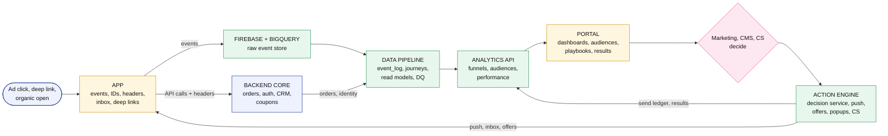
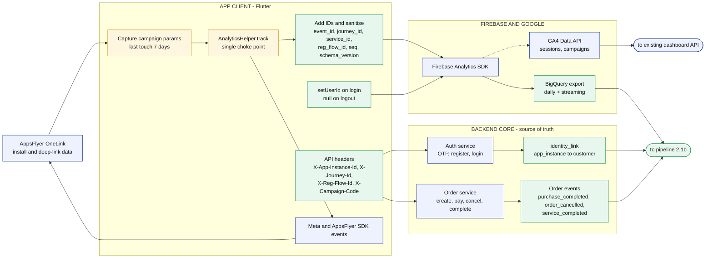
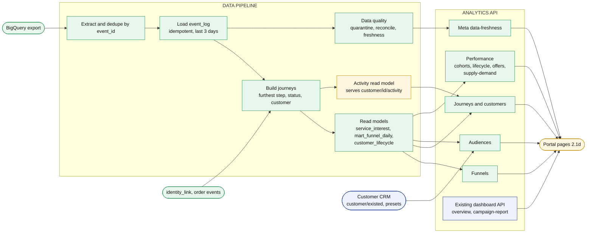
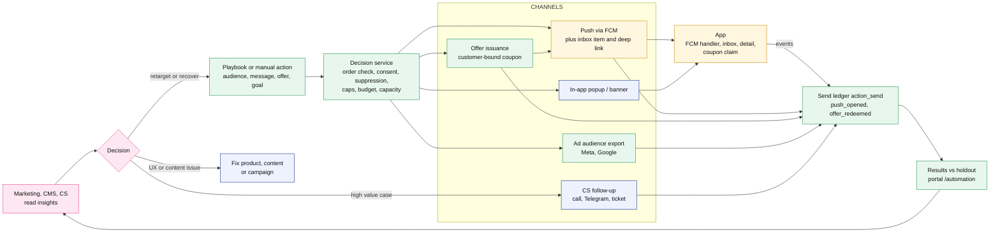
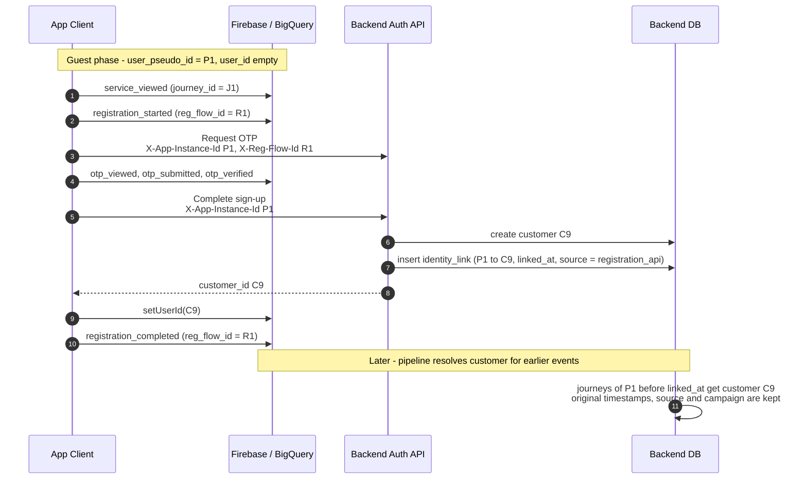
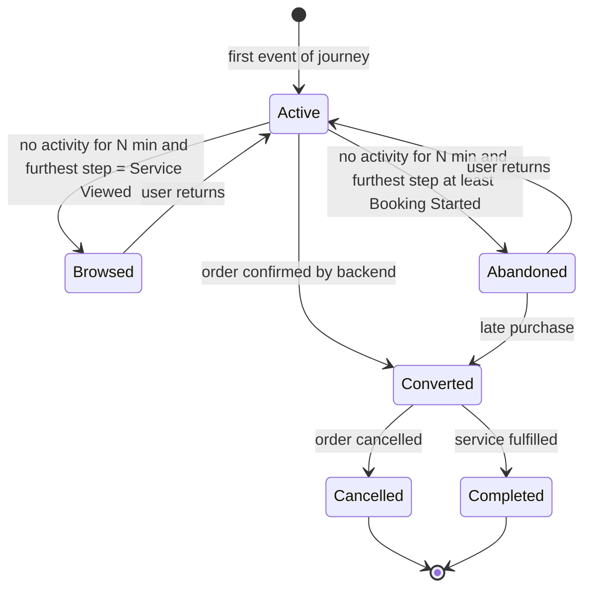
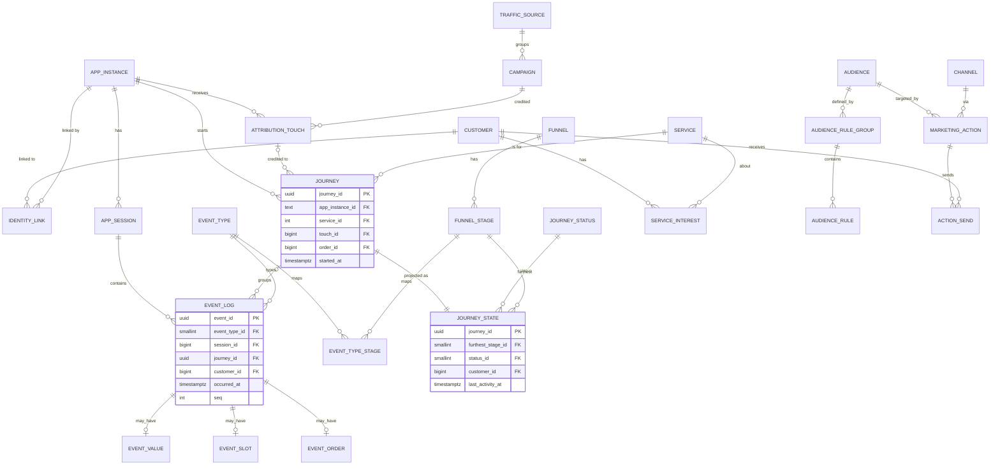

# bEasy Customer Journey Tracking — Architecture & Implementation Guide

**From event tracking → data storage → analysis → portal → decision & action**

Companion to *bEasy Customer Journey Developer Brief v2*. This guide answers: who does what (App vs Backend), how events should be shaped so the backend can map them easily, how to design the database (3NF), and which endpoints the portal needs.

> **Scope:** tracking → storage → analysis → portal → decision and action. Segment-driven automation (playbooks, push, in-app notification detail, coupons and discounts, business performance and ROI) is specified in the companion [bEasy-automation-engagement-guide.md](bEasy-automation-engagement-guide.md). Rollout phases for both are in §10.

> **Updated 8 Oct 2026 for UI v2.1** ([Journey_Tracking_UI_Flow_v2.1.md](../requirements/Journey_Tracking_UI_Flow_v2.1.md)). In-place changes: §2.1d route map, §2.3 and §5.4 journey status (per-step abandon rules), §6.4 config defaults. New material is in **§11 v2.1 additions** (events, tables, endpoints, jobs, privacy, impact per team). Where an older section disagrees with §11, §11 wins.

---

## Table of Contents

1. [Design principles](#1-design-principles)
2. [End-to-end workflow diagrams](#2-end-to-end-workflow-diagrams)
3. [Responsibility split: App vs Backend](#3-responsibility-split-app-vs-backend)
4. [Frontend event & parameter design](#4-frontend-event--parameter-design)
5. [Backend data pipeline](#5-backend-data-pipeline)
6. [Database design (3NF)](#6-database-design-3nf)
7. [API endpoints](#7-api-endpoints)
8. [Decision & action loop](#8-decision--action-loop)
9. [Data quality, monitoring & acceptance checklist](#9-data-quality-monitoring--acceptance-checklist)
10. [Rollout phases](#10-rollout-phases)
11. [v2.1 additions (UI of 7 Oct 2026)](#11-v21-additions-ui-of-7-oct-2026)

---

## 1. Design principles

1. **Firebase is the collector, not the source of truth.** Behaviour events (views, steps) come from Firebase. Money and order facts (purchase, payment, cancel, complete) come from the backend order system.
2. **Stable IDs, never names.** `service_id`, `zone_id`, `campaign_code` — display names live in the database.
3. **Every event carries its own dedupe key** (`event_id`) and, where relevant, a **journey key** (`journey_id`).
4. **Backend links identity itself.** The app sends `app_instance_id` to the backend at login/registration, so the backend does not have to guess the link from BigQuery.
5. **Raw data is immutable.** Raw → clean → modeled → read models. Fix problems by rebuilding downstream layers, never by editing raw.
6. **Rules before ML.** Furthest step, status and interest are deterministic rules for now (matches the brief: no 0–100 score yet).
7. **Close the loop.** Log every campaign send/open so Marketing can see whether an action worked.

---

## 2. End-to-end workflow diagrams

### 2.1 Overview: tracking → decision & action

One picture of the whole system. The next four sections zoom into each part. Colour shows build scope:

| Colour | Meaning |
|---|---|
| Blue | **Reuse** as is |
| Amber | **Extend** with new fields, events or screens |
| Green | **Build new** |
| Pink | **Human decision** |



| Zoom | Section |
|---|---|
| App, Firebase, backend core | 2.1a |
| Pipeline and analytics API | 2.1b |
| Decision and action loop | 2.1c |
| Portal routes and capability map | 2.1d |

### 2.1a Collection: app → Firebase → backend core



### 2.1b Pipeline and analytics API



### 2.1c Decision and action loop



### 2.1d Portal route map and capability map

Routes and sidebar groups as in `app/routes.ts` and `nav-config.ts`. Build list: `bEasy-portal/TODO.md`.

| Sidebar group | Route | Scope | Reads from |
|---|---|---|---|
| Overview | `/` Dashboard (App Data, Ads Data, campaign report) | Extend | Existing dashboard API; funnel snapshot from Q1 |
| Business Growth › Marketing › **Customer journey** (v2.1) | `/customer-journey` with tabs Booking funnel (default), Registration funnel, Acquisition funnel, Audiences; stage sheet over the funnel; `/customer-journey/abandon-rules` (admin) | Build new | Q1, Q2, Q3, Q4 |
| Business Growth › Analytics (later, P2) | `/attribution` | Build new, builds on campaign report | `dashboard/campaign-report`, attribution endpoints |
| | `/cohorts`, `/lifecycle`, `/supply-demand` | Build new | Q5 |
| Business Growth › Marketing | `/overview` | Reuse | `marketing/overview` |
| | `/audiences` | Moved into the Customer journey › Audiences tab in v2.1 (standalone page only if the tab outgrows it) | Q3, `customer/existed` |
| | `/playbooks`, `/message-templates` | Build new | Q4 |
| | `/automation` | Build new | Q4, Q5 |
| | `/push-notification` | Extend | Announcement API, Q4 results |
| | `/coupon` | Extend (offers) | Coupon API, offers API |
| | `/banner`, `/data-export` | Reuse | Existing |
| Support & Config › Customer Service | `/customer-overview`, `/registered-customer`, `/tickets` | Reuse | Existing |
| | `/customer` (List, Card view, filter presets) | Extend | `customer/existed`, `customer-segment`, Q2 |
| | `/customer/:id` (v2.1: tabs Summary, Journey, Event log, Orders, Contacts; `/customer/:id/journey` redirects to the Journey tab) | Extend | Q2 and activity read model |
| | `/cs-overview` (v2.1, name to confirm; `/customer-overview` already exists) | Build new | CS endpoints §11.4 |
| Setup | `/popup-banner` | Reuse | `popup/analytics/*` |
| | `/data-health` | Build new | Q6 |
| | `/rbac`, `/activity-log` | Extend (new modules, audit of rule and offer changes) | Existing |

Capability map: each need, the portal capability it builds on, and what this plan adds.

| Need | Portal capability used | Scope in this plan |
|---|---|---|
| Customer list with CRM filters | `/customer` calls `GET customer/existed` with recency, frequency, spender, AOV, revenue, service behaviour, timing status (Due Soon / Due Now / Overdue / Lost), last contact, promo usage. Export uses the same params | Add behaviour and journey filters (furthest step, status, events), estimate before save, AND / OR / EXCLUDE logic |
| Saved segments | Filter presets (`customer-segment` endpoint) and Card View tiles whose count equals the list's row count | Presets grow into audiences: behaviour and lifecycle rules, dynamic membership with enter / exit, usable as a playbook audience |
| Customer journey | `/customer/:id/journey` with `useCustomerJourney`: KPIs, activity chart, funnel, service interest, suggested actions, event log, CSV | Furthest step (6 stages) and status come from the backend; server-side aggregates; lifecycle, messages and offers shown on the customer |
| Funnels and campaign view | Dashboard **Ads Data** tab with `CampaignReportTable`: clicks → app opens → booking started → orders → revenue → conversion (GA4 Data API, `dashboard/campaign-report`) | `/funnels` for booking, registration and acquisition on unique journeys; `/attribution` adds registrations, CAC, ROAS and repeat rate next to the GA4 session-based figures |
| Push and announcements | `/push-notification`: topics by user type / gender / age, `GENERAL` or `PACKAGE_DEAL` (with coupons), schedule `NOW` / `SCHEDULED` / `RECURRING` / `EVENT_TRIGGERED`, trigger base `REGISTRATION` or `LAST_BOOKING` with time offset; detail lists users reached | Audience picker, holdout, goal, caps, results vs holdout; playbooks for multi-step automation |
| Coupons | `/coupon`: `isNewUserOnly`, min spend, max redeem, target users, products and options, expiry; `/coupons` finance view | Offers with per-customer issuance, budget, cost and ROI |
| In-app channel results | `/popup-banner` analytics: views, clicks, CTR, per-popup detail sheet | Same layout for notification and offer results |
| Overview and trend cards | `OverviewCard` with trend arrow and info tip, Recharts area charts, `DateRangePickerV2` | One shared period filter and baseline comparison on analytics pages |
| Access control | `MODULES`, `MODULE_META`, `MODULE_ACTIONS`, route `handle = { module, action }`, RBAC matrix, activity log | Modules for funnels, audiences, playbooks, templates, offers, data health |

> **Integration note:** the portal reads `GET customer/{id}/activity` (event name, category, product, option, estimated / booking / purchase value, order id). The `event_log` serves this same shape through the activity read model (P6 in 2.1b), so the journey screen keeps working while it moves to journey state. Confirm with backend how this endpoint is populated.

### 2.2 Identity linking: guest → registered



### 2.3 Journey status lifecycle



> **v2.1:** `N` is no longer one number. It is set **per furthest step** in `abandon_rule` (Viewed 24 h, Booking started 1 h, Details 1 h, Slot 1 h, Checkout 30 min, Payment failed 30 min). *Abandoned* is a CRM status; *Dropped here* is a reporting count and is not stored as a status. "Browsed" is kept only until Marketing confirms it can be replaced by *Abandoned at Service viewed* (matrix N3). A purchase clears Abandoned at once.

---

## 3. Responsibility split: App vs Backend

| Concern | App Client | Firebase / BigQuery | Backend | Portal |
|---|---|---|---|---|
| Fire behaviour events (view, booking steps, registration steps) | **Owns** | Stores | Consumes | — |
| Generate `event_id`, `journey_id`, `reg_flow_id`, `seq` | **Owns** | — | Validates format | — |
| `setUserId` / clear on logout | **Owns** | Stores | — | — |
| Get `app_instance_id` and send to backend on login/register | **Owns** | Source of ID | **Stores `identity_link`** | — |
| Capture deep link / campaign params | **Owns** | — | Resolves to `campaign` | — |
| Send `journey_id` header on booking / checkout / order APIs | **Owns** | — | **Ties order to journey** | — |
| Purchase, payment, cancel, complete | Shows UI only | — | **Owns (source of truth)** | — |
| Raw event storage | — | **Owns** (export) | Reads only | — |
| Dedupe, flatten params, load to DB | — | — | **Owns** | — |
| Identity stitching (guest → user) | Sends IDs | — | **Owns** | — |
| Furthest step, journey status, interest level | — | — | **Owns** | Displays |
| Funnel / audience / attribution queries | — | — | **Owns (API)** | Calls API |
| Event-log, funnel, audience-builder UI | — | — | — | **Owns** |
| Push / ad audience sending, suppression, frequency cap | Handles deep link and logs `push_opened` | — | **Owns** | Triggers |
| Decision on what to do next | — | — | — | **Marketing / CMS** |

**Rule of thumb:** the client reports *what the user did on screen*; the backend decides *what it means* and records *what really happened to the order*.

---

## 4. Frontend event & parameter design

Goal: every event can be loaded into the backend **without guessing**.

### 4.1 Naming rules

- Event and param names: `snake_case`, max 40 characters, English only.
- String param values: max 100 characters (Firebase limit). Use IDs and short codes, never free text or long addresses.
- Do not use Firebase reserved event names (`first_open`, `session_start`, `app_remove`, etc.). Prefix nothing; just avoid collisions.
- Send numbers as **numbers** and always the same type (`value` always as a decimal, e.g. `30.0`). BigQuery stores ints and doubles in different columns, so inconsistency causes mapping bugs.
- One wrapper function for the whole app. No direct `logEvent` calls scattered in screens.

### 4.2 Auto-collected by Firebase (do **not** send manually)

| Data | BigQuery field | Use |
|---|---|---|
| App instance ID (guest ID) | `user_pseudo_id` | Guest identifier |
| User ID (after `setUserId`) | `user_id` | Registered identifier |
| Event time (device clock) | `event_timestamp` (microseconds) | `occurred_at` |
| Firebase session number | `ga_session_id` event param | `app_session` |
| Platform, app version, OS | `platform`, `app_info.version`, `device.operating_system_version` | `app_session` |

**Never send** IDFA / Android ad ID / phone number / email / full address as params or as the user ID.

### 4.3 Common params on every custom event

| Param | Type | Example | Required | Purpose |
|---|---|---|---|---|
| `event_id` | string (UUIDv4) | `"7f9c…"` | Always | Dedupe key and primary key in `event_log` |
| `schema_version` | int | `1` | Always | Lets backend handle old app versions |
| `seq` | int | `42` | Always | Counter that increases per app launch; orders events with the same timestamp |
| `journey_id` | string (UUIDv4) | `"a1b2…"` | All service/booking events | One journey = one user + one service. Created at the first `service_viewed` for that service and reused until purchase or expiry |
| `service_id` | int | `12` | All service/booking events | Stable service key |
| `reg_flow_id` | string (UUIDv4) | `"c3d4…"` | All registration events | One registration attempt; makes the registration funnel countable |

**Journey rules (must be identical on iOS and Android):**
- New `journey_id` when the user views a service and has no active journey for it.
- Reuse the same `journey_id` across app sessions until the order is confirmed or **24 h** of inactivity (configurable constant shared with backend).
- After purchase, the next view of the same service starts a **new** journey.

### 4.4 Event dictionary

**Owner** = who emits the record in `event_log`. "Backend" events are written from order data, not from the app.

| Event | Owner | Funnel stage | Extra params (beyond common) |
|---|---|---|---|
| `app_opened` | Client | Acquisition | `entry_type` (`organic`/`deeplink`/`push`), `campaign_code`, `utm_source`, `utm_medium`, `service_id` (if deep link) |
| `service_list_viewed` | Client | — | — |
| `service_viewed` | Client | Booking 1 | `entry_point` (`home`/`search`/`banner`/`push`/`deeplink`) |
| `booking_started` | Client | Booking 2 | — |
| `address_selected` | Client | — | `zone_id` (int, nullable until the backend returns it on addresses), `area_cell` (coordinates rounded to 2 decimals, `lat_lng`, about 1 km; at least one of the two). **Never** a street address or the address row id |
| `service_option_selected` | Client | — | `option_group_id`, `option_id` (backend maps to `product_option_id`; see [pending-request-backend.md](../backend-request/pending-request-backend.md) §1) |
| `addon_group_viewed` | Client | — | `addon_group_id`, `is_required`, `item_count` |
| `addon_selected` / `addon_quantity_changed` / `addon_removed` | Client | — | `addon_id`, `addon_group_id`, `quantity`; `value`, `currency` on select |
| `task_info_viewed` / `equipment_viewed` | Client | — | — (content views; `service_id` identifies the service) |
| `pair_service_viewed` | Client | — | `item_count` |
| `pair_service_selected` | Client | — | `pair_service_id` (category id), `position` |
| `pair_service_added` | Client | — | `pair_service_id`, `option_id`, `quantity`, `value`, `currency` |
| `pair_service_removed` | Client | — | `option_id` |
| `duration_selected` | Client | — | `duration_hours` (double) |
| `date_selected` / `time_selected` | Client | — | `slot_date` (`YYYY-MM-DD`) / `slot_time` (`HH:mm`) |
| `booking_details_completed` | Client | Booking 3 | `value`, `currency` (estimated value) |
| `slot_selected` | Client | Booking 4 | `slot_start` (ISO-8601 with offset, e.g. `2026-09-28T14:00:00+07:00`), `value`, `currency` |
| `booking_summary_viewed` | Client | — | `value`, `currency` |
| `promo_applied` | Client | — | `promo_code`, `promo_result` (`valid`/`invalid`) |
| `checkout_started` | Client | Booking 5 | `value`, `currency`, `promo_code` (optional) |
| `payment_started` | Client | — | `payment_method` (enum), `value`, `currency` |
| `order_confirmation_viewed` | Client | — | UI signal only; **not** the purchase record |
| `purchase_completed` | **Backend** | Booking 6 | `order_id`, `value`, `currency` |
| `order_cancelled` | **Backend** | Post | `order_id`, `value` |
| `service_completed` | **Backend** | Post | `order_id`, `value` |
| `registration_started` | Client | Registration 1 | `entry` (`gate`/`onboarding`/`checkout_gate`), `campaign_code` |
| `otp_viewed` | Client | Registration 2 | — |
| `otp_submitted` | Client | — | `attempt_no` |
| `otp_failed` | Client | — | `error_code` |
| `otp_resend_clicked` | Client | — | — |
| `otp_verified` | Client | Registration 3 | — |
| `signup_viewed` | Client | Registration 4 | — |
| `registration_completed` | Client + Backend | Registration 5 | Client emits after `setUserId`; backend also records from the auth service (source of truth) |
| `push_opened` | Client | Action loop | `action_id`, `send_id`, `notification_id` (from the push payload) |

> Notification inbox, detail-screen, offer and consent events (`notification_detail_viewed`, `offer_claimed`, `offer_redeemed`, …) are defined in [bEasy-automation-engagement-guide.md §11](bEasy-automation-engagement-guide.md#11-event-dictionary).

> Payment and order facts should be written by the backend from the orders table, so a failed client upload can never hide a real order. The client still fires its UI events for funnel diagnostics.

### 4.5 Attribution capture (client)

1. On app open via deep link or push, read `utm_source`, `utm_medium`, `campaign_code` (and `service_id`).
2. Log `app_opened` with those params.
3. Store the last-touch campaign locally with a short expiry (e.g. 7 days) so registration can use it.
4. Send the stored `campaign_code` to the backend at registration (`X-Campaign-Code` header). The backend writes `attribution_touch`; there is no need to copy campaign params onto every event.
5. Set two Firebase user properties only: `auth_state` (`guest`/`registered`) and `first_campaign` (set once).

> **Check before committing:** Firebase Dynamic Links was shut down in 2025. Decide how deferred deep links and Meta attribution work (Universal Links / App Links, or an attribution provider such as AppsFlyer / Adjust / Branch) and confirm against current docs.

### 4.6 Headers on backend API calls

These let the backend join app behaviour to orders and identity **without BigQuery**.

| Header | Sent on | Value |
|---|---|---|
| `X-App-Instance-Id` | OTP, register, login, create-order | Firebase app instance ID (`user_pseudo_id`) |
| `X-Journey-Id` | Booking draft, checkout, create-order | Journey of the service being ordered (create-order is pinned to the ordered service) |
| `X-Reg-Flow-Id` | OTP request, verify, sign-up | Current `reg_flow_id` |
| `X-Campaign-Code` | Registration | Stored last-touch campaign (optional) |
| `X-Event-Seq` | Optional | Current `seq` for debugging |

### 4.7 Wrapper pseudo-code

```text
track(eventName, params):
    base = {
        event_id:       uuidV4(),
        schema_version: 1,
        seq:            nextSeq()          // persisted counter per app launch
    }
    base.journey_id  = journeyStore.currentFor(params.service_id)   // if service event
    base.reg_flow_id = registrationStore.current()                  // if registration event
    validate(eventName, merge(base, params))   // required params present, types correct, ≤100 chars
    firebase.logEvent(eventName, merge(base, params))

onLogin(customerId):  firebase.setUserId(customerId)
onLogout():           firebase.setUserId(null); journeyStore.clear()
```

`validate` should **throw in debug builds** and log a warning in release builds, so contract mistakes are caught before they reach BigQuery.

### 4.8 Example payloads

`service_viewed`
```json
{
  "event_id": "7f9c1d52-3a11-4e08-9b0a-61c3f1d7e001",
  "schema_version": 1,
  "seq": 14,
  "journey_id": "a1b2c3d4-0000-4f00-8000-00000000j001",
  "service_id": 12,
  "entry_point": "banner"
}
```

`slot_selected`
```json
{
  "event_id": "7f9c1d52-3a11-4e08-9b0a-61c3f1d7e019",
  "schema_version": 1,
  "seq": 21,
  "journey_id": "a1b2c3d4-0000-4f00-8000-00000000j001",
  "service_id": 12,
  "slot_start": "2026-09-28T14:00:00+07:00",
  "value": 30.0,
  "currency": "USD"
}
```

`create-order` request headers
```http
POST /api/v1/orders
Authorization: Bearer <token>
X-App-Instance-Id: 3F2A9C71.1727780000
X-Journey-Id: a1b2c3d4-0000-4f00-8000-00000000j001
```

### 4.9 Client-side do / don't

| Do | Don't |
|---|---|
| Use the wrapper and the dictionary above | Add ad-hoc events without updating the tracking plan |
| Send `service_id` | Send service names |
| Send `zone_id` | Send street address |
| Use a separate Firebase project / data stream for dev and staging | Test against the production stream |
| Bump `schema_version` when params change | Rename params silently |
| Debounce screen-rebuild duplicates (e.g. fire `service_viewed` once per screen entry) | Fire on every re-render |

---

## 5. Backend data pipeline

### 5.1 Layers

| Layer | Location | Content | Rule |
|---|---|---|---|
| **L0 Raw** | BigQuery `events_*` and `events_intraday_*` | Firebase export as-is | Never edited |
| **L1 Clean** | BigQuery view/table or staging schema | One row per `event_id`, params flattened, typed | Deduped by `event_id` |
| **L2 Core (3NF)** | Backend DB (PostgreSQL) | `event_log`, `journey`, `app_session`, `identity_link`… | Source for all analysis |
| **L3 Read models** | Backend DB | `journey_state`, `service_interest`, `mart_funnel_daily` | Rebuildable any time |
| **L4 API** | Backend service | Filter endpoints | Reads L2/L3 only |

### 5.2 Schedule

| Job | Frequency | Notes |
|---|---|---|
| Intraday extract (streaming export) | Every 5–15 min | Only if near-real-time recovery push is needed |
| Daily extract + reprocess **last 3 days** | Daily | Daily tables can be updated late; the upsert by `event_id` makes this safe |
| Journey state recompute | After each load, for touched journeys only | Furthest step, status, resolved customer |
| Service interest recompute | After journey state | Per customer + service |
| Funnel mart rebuild | After journey state | Last 3 days of dates |
| Abandonment sweep | Every 5 min | Moves `active → abandoned/browsed` when the threshold passes |
| Reconciliation | Daily | Compare Firebase vs orders (see §9) |

> **Backend status (5 Oct 2026):** the backend reads `X-Journey-Id` only on `POST /api/customer/order/v6/create`. Reading it on preview, coupon, calculation, add-on, schedule and checkout is requested in [backend-request/pending-request-backend.md](../backend-request/pending-request-backend.md); until then recovery pushes cannot use API state and must use the BigQuery import.

> **Recovery push timing:** prefer backend state (booking draft / checkout API calls with `X-Journey-Id`) as the trigger, since it is deterministic. Use intraday BigQuery as a fallback.

### 5.3 Extract query (BigQuery → clean)

```sql
-- Daily tables only. Intraday tables need a separate query on events_intraday_*.
SELECT
  (SELECT value.string_value FROM UNNEST(event_params) WHERE key = 'event_id')        AS event_id,
  event_name,
  user_pseudo_id                                                                       AS app_instance_id,
  user_id                                                                              AS customer_id_raw,
  TIMESTAMP_MICROS(event_timestamp)                                                    AS occurred_at,
  platform,
  app_info.version                                                                     AS app_version,
  (SELECT value.int_value    FROM UNNEST(event_params) WHERE key = 'ga_session_id')    AS ga_session_id,
  (SELECT value.int_value    FROM UNNEST(event_params) WHERE key = 'schema_version')   AS schema_version,
  (SELECT value.int_value    FROM UNNEST(event_params) WHERE key = 'seq')              AS seq,
  (SELECT value.string_value FROM UNNEST(event_params) WHERE key = 'journey_id')       AS journey_id,
  (SELECT value.string_value FROM UNNEST(event_params) WHERE key = 'reg_flow_id')      AS reg_flow_id,
  (SELECT value.int_value    FROM UNNEST(event_params) WHERE key = 'service_id')       AS service_id,
  -- numbers can arrive as int or double: always COALESCE
  COALESCE(
    (SELECT value.double_value FROM UNNEST(event_params) WHERE key = 'value'),
    (SELECT CAST(value.int_value AS FLOAT64) FROM UNNEST(event_params) WHERE key = 'value')
  )                                                                                    AS amount,
  (SELECT value.string_value FROM UNNEST(event_params) WHERE key = 'currency')         AS currency,
  (SELECT value.string_value FROM UNNEST(event_params) WHERE key = 'slot_start')       AS slot_start,
  (SELECT value.int_value    FROM UNNEST(event_params) WHERE key = 'zone_id')          AS zone_id,
  (SELECT value.string_value FROM UNNEST(event_params) WHERE key = 'area_cell')        AS area_cell
FROM `PROJECT.analytics_XXXXXXXX.events_*`
WHERE REGEXP_CONTAINS(_TABLE_SUFFIX, r'^\d{8}$')
  AND _TABLE_SUFFIX BETWEEN @from_date AND @to_date
  AND event_name IN (SELECT name FROM `PROJECT.tracking.event_whitelist`)
QUALIFY ROW_NUMBER() OVER (
  PARTITION BY (SELECT value.string_value FROM UNNEST(event_params) WHERE key = 'event_id')
  ORDER BY event_timestamp
) = 1;
```

Rows with missing/invalid `event_id` or unknown `service_id` go to a **quarantine table** with the reason, and are counted on the data-quality dashboard. They are never silently dropped. Unknown `event_name` values (legacy events such as `view_content`) are skipped, not quarantined (agreed with the backend, [tracking-backend.md](tracking-backend.md) §13).

### 5.4 Journey build rules

1. Group events by `journey_id`; create `journey` if new (`app_instance_id`, `service_id`, `started_at`).
2. `furthest_stage` = highest booking-funnel stage level among the journey's events.
3. `last_activity_at` = latest `occurred_at` of a meaningful event.
4. Status:
   - `converted` if backend order exists for the journey (via `X-Journey-Id` on create-order).
   - `cancelled` / `completed` from order status.
   - Otherwise `abandoned` if furthest ≥ Booking Started and idle > threshold; `browsed` if furthest = Service Viewed and idle > threshold; else `active`.
5. Resolve customer: from `identity_link` where `linked_at` ≥ the journey's first event, within the configured link window (see §6.4). Never overwrite `started_at`, campaign or service.

### 5.5 Identity stitching rules

- **Primary:** the backend writes `identity_link` when it receives `X-App-Instance-Id` on login/registration.
- **Fallback (optional):** infer from BigQuery rows where `user_pseudo_id` and `user_id` appear together; mark `link_source = 'bq_inference'` and lower trust.
- One device can link to several customers and one customer to several devices. Use `linked_at` / `unlinked_at` to choose the right owner for each event; on logout, close the link.
- App reinstall creates a new `app_instance_id`; guest history before it cannot be linked until the user logs in again.
- Apply linking only where consent/privacy setup allows (brief §14.4).

---

## 6. Database design (3NF)

PostgreSQL syntax. Reuse your existing `customer`, `orders` and `service` tables where they exist; they are shown only as FK targets.

### 6.1 Normalization approach

| Zone | Normal form | Why |
|---|---|---|
| **Core** (reference, identity, attribution, journey, events) | **3NF** | Facts stored once; no transitive dependencies |
| **Read models** (`journey_state`, `service_interest`, `mart_funnel_daily`) | Deliberately derived | Rebuildable projections for fast portal queries; never edited by hand |
| **Audience & action** | **3NF** | Rules and sends are transactional data |

Key 3NF decisions:
- `event_log` does **not** repeat `app_instance_id`, platform or app version; they come through `session_id → app_session → app_instance`.
- `journey` does **not** store campaign name or source; it points to `attribution_touch → campaign → traffic_source`.
- Monetary value, slot time and order link are in 1:0..1 side tables (`event_value`, `event_slot`, `event_order`, `event_location`) so `event_log` has no sparse nullable columns.
- Stage, status, channel, operator and similar enumerations are lookup tables.
- Event ↔ funnel stage is many-to-many (`event_type_stage`) because one event counts in both the Booking and Acquisition funnels.

### 6.2 ER diagram



### 6.3 DDL: reference tables

```sql
-- Reuse existing tables if present. Shown for completeness.
CREATE TABLE service (
  service_id  integer PRIMARY KEY,            -- stable key used in app events
  code        text    NOT NULL UNIQUE,
  name        text    NOT NULL,
  is_active   boolean NOT NULL DEFAULT true
);

CREATE TABLE funnel (
  funnel_id   smallint PRIMARY KEY,
  code        text NOT NULL UNIQUE            -- 'booking' | 'registration' | 'acquisition'
);

CREATE TABLE funnel_stage (
  stage_id    smallint PRIMARY KEY,
  funnel_id   smallint NOT NULL REFERENCES funnel(funnel_id),
  code        text     NOT NULL,
  name        text     NOT NULL,
  level       smallint NOT NULL,              -- order inside the funnel
  UNIQUE (funnel_id, code),
  UNIQUE (funnel_id, level)
);

CREATE TABLE event_type (
  event_type_id smallint PRIMARY KEY,
  name          text    NOT NULL UNIQUE,      -- 'service_viewed', ...
  owner_system  text    NOT NULL CHECK (owner_system IN ('client','backend')),
  is_meaningful boolean NOT NULL DEFAULT true -- counted in CRM activity counts
);

-- many-to-many: one event can count in several funnels
CREATE TABLE event_type_stage (
  event_type_id smallint NOT NULL REFERENCES event_type(event_type_id),
  stage_id      smallint NOT NULL REFERENCES funnel_stage(stage_id),
  PRIMARY KEY (event_type_id, stage_id)
);

CREATE TABLE journey_status (
  status_id smallint PRIMARY KEY,
  code      text NOT NULL UNIQUE              -- active, browsed, abandoned, converted, cancelled, completed
);

CREATE TABLE interest_level (
  interest_level_id smallint PRIMARY KEY,
  code              text     NOT NULL UNIQUE, -- low, medium, high, very_high, converted
  rank              smallint NOT NULL UNIQUE
);

CREATE TABLE pipeline_config (
  config_key   text PRIMARY KEY,              -- e.g. abandon_after_minutes, link_window_days
  config_value text NOT NULL
);
```

### 6.4 DDL: identity, session, attribution

```sql
CREATE TABLE app_instance (
  app_instance_id text PRIMARY KEY,           -- Firebase user_pseudo_id
  platform        text NOT NULL CHECK (platform IN ('ios','android')),
  first_seen_at   timestamptz NOT NULL,
  last_seen_at    timestamptz NOT NULL
);

CREATE TABLE identity_link (
  link_id         bigserial PRIMARY KEY,
  app_instance_id text   NOT NULL REFERENCES app_instance(app_instance_id),
  customer_id     bigint NOT NULL REFERENCES customer(customer_id),
  linked_at       timestamptz NOT NULL,
  unlinked_at     timestamptz,                -- set on logout
  link_source     text NOT NULL CHECK (link_source IN ('registration_api','login_api','bq_inference')),
  UNIQUE (app_instance_id, customer_id, linked_at)
);

CREATE TABLE app_session (
  session_id      bigserial PRIMARY KEY,
  app_instance_id text   NOT NULL REFERENCES app_instance(app_instance_id),
  ga_session_id   bigint NOT NULL,
  started_at      timestamptz NOT NULL,
  ended_at        timestamptz,
  app_version     text,
  os_version      text,
  UNIQUE (app_instance_id, ga_session_id)
);

CREATE TABLE traffic_source (
  source_id smallint PRIMARY KEY,
  source    text NOT NULL,                    -- meta, google, organic, push, referral
  medium    text NOT NULL,                    -- cpc, social, email...
  UNIQUE (source, medium)
);

CREATE TABLE campaign (
  campaign_id          integer PRIMARY KEY,   -- 0 = organic / unknown (sentinel row)
  source_id            smallint NOT NULL REFERENCES traffic_source(source_id),
  campaign_code        text     NOT NULL,     -- value sent by the app
  name                 text     NOT NULL,
  external_campaign_id text,                  -- ad platform ID
  UNIQUE (source_id, campaign_code)
);

CREATE TABLE promo_code (
  promo_code_id integer PRIMARY KEY,
  code          text NOT NULL UNIQUE
);

CREATE TABLE attribution_touch (
  touch_id        bigserial PRIMARY KEY,
  app_instance_id text    NOT NULL REFERENCES app_instance(app_instance_id),
  campaign_id     integer NOT NULL REFERENCES campaign(campaign_id),
  promo_code_id   integer REFERENCES promo_code(promo_code_id),
  touched_at      timestamptz NOT NULL
);
```

Config defaults: `link_window_days = 30` (how far back a registration may claim earlier guest journeys on the same device), `journey_idle_hours = 24`. **v2.1:** `abandon_after_minutes = 60` is replaced by the `abandon_rule` table (§11.2).

### 6.5 DDL: journey and events

```sql
CREATE TABLE journey (
  journey_id      uuid PRIMARY KEY,           -- generated by the app
  app_instance_id text    NOT NULL REFERENCES app_instance(app_instance_id),
  service_id      integer NOT NULL REFERENCES service(service_id),
  touch_id        bigint  REFERENCES attribution_touch(touch_id),
  order_id        bigint  UNIQUE REFERENCES orders(order_id),  -- set from X-Journey-Id on create-order
  started_at      timestamptz NOT NULL
);

CREATE TABLE event_log (
  event_id       uuid PRIMARY KEY,            -- app-generated, dedupe key
  event_type_id  smallint NOT NULL REFERENCES event_type(event_type_id),
  session_id     bigint   NOT NULL REFERENCES app_session(session_id),
  journey_id     uuid     REFERENCES journey(journey_id),     -- null for non-journey events
  customer_id    bigint   REFERENCES customer(customer_id),   -- Firebase user_id at event time (raw)
  occurred_at    timestamptz NOT NULL,        -- device time
  received_at    timestamptz NOT NULL DEFAULT now(),
  seq            integer,
  schema_version smallint NOT NULL DEFAULT 1
);

CREATE TABLE event_value (
  event_id      uuid PRIMARY KEY REFERENCES event_log(event_id) ON DELETE CASCADE,
  amount        numeric(12,2) NOT NULL,
  currency_code char(3)       NOT NULL
);

CREATE TABLE event_slot (
  event_id   uuid PRIMARY KEY REFERENCES event_log(event_id) ON DELETE CASCADE,
  slot_start timestamptz NOT NULL
);

CREATE TABLE event_order (
  event_id uuid   PRIMARY KEY REFERENCES event_log(event_id) ON DELETE CASCADE,
  order_id bigint NOT NULL REFERENCES orders(order_id)
);

-- location of an address_selected event: backend zone when the app had it, else a coarse grid cell
CREATE TABLE event_location (
  event_id  uuid PRIMARY KEY REFERENCES event_log(event_id) ON DELETE CASCADE,
  zone_id   integer REFERENCES zone(zone_id),      -- backend zone table; null when the app sent only area_cell
  area_cell text,                                  -- 'lat_lng' rounded to 2 decimals
  CHECK (zone_id IS NOT NULL OR area_cell IS NOT NULL)
);

-- resolves grid cells to zones, so events without zone_id still count per zone
CREATE TABLE area_cell_zone (
  area_cell text PRIMARY KEY,
  zone_id   integer NOT NULL REFERENCES zone(zone_id)
);

-- registration attempts (separate from service journeys)
CREATE TABLE registration_flow (
  reg_flow_id     uuid PRIMARY KEY,
  app_instance_id text NOT NULL REFERENCES app_instance(app_instance_id),
  touch_id        bigint REFERENCES attribution_touch(touch_id),
  started_at      timestamptz NOT NULL,
  customer_id     bigint REFERENCES customer(customer_id)     -- set on completion
);
-- registration events reference reg_flow_id via a bridge to keep event_log generic
CREATE TABLE event_registration (
  event_id    uuid PRIMARY KEY REFERENCES event_log(event_id) ON DELETE CASCADE,
  reg_flow_id uuid NOT NULL REFERENCES registration_flow(reg_flow_id)
);

CREATE INDEX ix_event_log_journey    ON event_log (journey_id, occurred_at);
CREATE INDEX ix_event_log_session    ON event_log (session_id, occurred_at);
CREATE INDEX ix_event_log_type_time  ON event_log (event_type_id, occurred_at);
CREATE INDEX ix_journey_service_time ON journey (service_id, started_at);
CREATE INDEX ix_journey_instance     ON journey (app_instance_id, started_at);
CREATE INDEX ix_link_instance        ON identity_link (app_instance_id, linked_at);
CREATE INDEX ix_link_customer        ON identity_link (customer_id);
```

> For large volume, partition `event_log` by month on `occurred_at`.

### 6.6 DDL: read models (derived, rebuildable)

```sql
CREATE TABLE journey_state (
  journey_id             uuid PRIMARY KEY REFERENCES journey(journey_id) ON DELETE CASCADE,
  furthest_stage_id      smallint NOT NULL REFERENCES funnel_stage(stage_id),  -- booking funnel
  status_id              smallint NOT NULL REFERENCES journey_status(status_id),
  customer_id            bigint   REFERENCES customer(customer_id),            -- resolved via identity_link
  last_activity_at       timestamptz NOT NULL,
  meaningful_event_count integer  NOT NULL,
  computed_at            timestamptz NOT NULL DEFAULT now()
);

CREATE TABLE service_interest (
  customer_id        bigint   NOT NULL REFERENCES customer(customer_id),
  service_id         integer  NOT NULL REFERENCES service(service_id),
  interest_level_id  smallint NOT NULL REFERENCES interest_level(interest_level_id),
  furthest_stage_id  smallint NOT NULL REFERENCES funnel_stage(stage_id),
  view_count         integer  NOT NULL,
  session_count      integer  NOT NULL,
  first_seen_at      timestamptz NOT NULL,
  last_seen_at       timestamptz NOT NULL,
  last_booking_value numeric(12,2),
  computed_at        timestamptz NOT NULL DEFAULT now(),
  PRIMARY KEY (customer_id, service_id)
);

CREATE TABLE mart_funnel_daily (
  stat_date     date     NOT NULL,
  service_id    integer  NOT NULL REFERENCES service(service_id),
  campaign_id   integer  NOT NULL REFERENCES campaign(campaign_id),   -- 0 = organic/unknown
  platform      text     NOT NULL,
  is_registered boolean  NOT NULL,
  stage_id      smallint NOT NULL REFERENCES funnel_stage(stage_id),
  journeys      integer  NOT NULL,
  PRIMARY KEY (stat_date, service_id, campaign_id, platform, is_registered, stage_id)
);

CREATE INDEX ix_js_status_time ON journey_state (status_id, last_activity_at);
CREATE INDEX ix_js_customer    ON journey_state (customer_id);
CREATE INDEX ix_si_level       ON service_interest (interest_level_id, last_seen_at);
```

Interest rules (from the brief): Low = Service Viewed; Medium = repeated views or Booking Started; High = Details Completed / Slot Selected (recent); Very High = Checkout Started, no purchase, very recent; Converted = purchase. Guests have journeys but no `service_interest` rows until their device is linked to a customer.

**Funnel query straight from `journey_state` (any filter combination):**

```sql
WITH j AS (
  SELECT jr.journey_id, fs.level AS furthest_level
  FROM journey jr
  JOIN journey_state js ON js.journey_id = jr.journey_id
  JOIN funnel_stage  fs ON fs.stage_id   = js.furthest_stage_id
  WHERE jr.service_id = ANY(:service_ids)
    AND jr.started_at >= :from AND jr.started_at < :to
)
SELECT st.level, st.name, COUNT(j.journey_id) AS journeys
FROM funnel f
JOIN funnel_stage st ON st.funnel_id = f.funnel_id
LEFT JOIN j ON j.furthest_level >= st.level
WHERE f.code = 'booking'
GROUP BY st.level, st.name
ORDER BY st.level;
```

Stage N = number of journeys whose furthest level is **at least** N. Conversion from previous and drop-off are computed from these counts in the API layer.

### 6.7 DDL: audience, actions, suppression

```sql
CREATE TABLE audience (
  audience_id bigserial PRIMARY KEY,
  name        text   NOT NULL,
  created_by  bigint NOT NULL,                -- admin user
  created_at  timestamptz NOT NULL DEFAULT now(),
  is_saved    boolean NOT NULL DEFAULT false,
  is_dynamic  boolean NOT NULL DEFAULT false  -- true = live membership (segment_membership), false = snapshot
);

CREATE TABLE filter_field (
  field_id  smallint PRIMARY KEY,
  code      text NOT NULL UNIQUE,   -- crm_segment, service, behaviour_event, time_window, frequency, furthest_step, journey_status
  data_type text NOT NULL
);

CREATE TABLE filter_operator (
  operator_id smallint PRIMARY KEY,
  code        text NOT NULL UNIQUE  -- IS, IS_NOT, HAS, HAS_NOT, WITHIN, BEFORE, AFTER, AT_LEAST, AT_MOST, EXACTLY
);

CREATE TABLE audience_rule_group (
  group_id        bigserial PRIMARY KEY,
  audience_id     bigint NOT NULL REFERENCES audience(audience_id) ON DELETE CASCADE,
  parent_group_id bigint REFERENCES audience_rule_group(group_id),
  logic           text   NOT NULL CHECK (logic IN ('AND','OR','EXCLUDE'))
);

CREATE TABLE audience_rule (
  rule_id        bigserial PRIMARY KEY,
  group_id       bigint   NOT NULL REFERENCES audience_rule_group(group_id) ON DELETE CASCADE,
  field_id       smallint NOT NULL REFERENCES filter_field(field_id),
  operator_id    smallint NOT NULL REFERENCES filter_operator(operator_id),
  value_text     text     NOT NULL,           -- ONE value per row; multiple values = several rows in an OR group
  window_minutes integer                      -- for time rules
);

CREATE TABLE audience_snapshot (
  snapshot_id  bigserial PRIMARY KEY,
  audience_id  bigint NOT NULL REFERENCES audience(audience_id),
  taken_at     timestamptz NOT NULL DEFAULT now(),
  member_count integer NOT NULL
);

CREATE TABLE audience_snapshot_member (
  snapshot_id bigint NOT NULL REFERENCES audience_snapshot(snapshot_id) ON DELETE CASCADE,
  customer_id bigint NOT NULL REFERENCES customer(customer_id),
  PRIMARY KEY (snapshot_id, customer_id)
);

CREATE TABLE channel (
  channel_id smallint PRIMARY KEY,
  code       text NOT NULL UNIQUE           -- push, meta_ads, google_ads, cs_call
);

CREATE TABLE marketing_action (
  action_id    bigserial PRIMARY KEY,
  audience_id  bigint   NOT NULL REFERENCES audience(audience_id),
  campaign_id  integer  REFERENCES campaign(campaign_id),
  channel_id   smallint NOT NULL REFERENCES channel(channel_id),
  name         text     NOT NULL,
  status       text     NOT NULL CHECK (status IN ('draft','scheduled','running','done','cancelled')),
  holdout_pct  numeric(5,2) NOT NULL DEFAULT 0,
  scheduled_at timestamptz,
  created_by   bigint   NOT NULL,
  created_at   timestamptz NOT NULL DEFAULT now()
);

CREATE TABLE suppression_reason (
  reason_id smallint PRIMARY KEY,
  code      text NOT NULL UNIQUE            -- converted, no_push_token, manual, freq_cap, holdout
);

CREATE TABLE action_send (
  send_id      bigserial PRIMARY KEY,
  action_id    bigint NOT NULL REFERENCES marketing_action(action_id),
  customer_id  bigint NOT NULL REFERENCES customer(customer_id),
  is_holdout   boolean NOT NULL DEFAULT false,
  reason_id    smallint REFERENCES suppression_reason(reason_id),  -- set when NOT sent
  run_id       bigint,                        -- playbook_run (automation guide §10); null for manual actions
  step_id      integer,                       -- playbook_step
  variant_id   integer,                       -- experiment_variant (P2)
  sent_at      timestamptz,
  delivered_at timestamptz,
  opened_at    timestamptz,
  clicked_at   timestamptz
);
-- one send per customer per action, per playbook run and step
CREATE UNIQUE INDEX ux_send_once ON action_send (action_id, customer_id, COALESCE(step_id, 0), COALESCE(run_id, 0));
-- FKs for run_id, step_id, variant_id are declared in automation guide §10.5

CREATE TABLE marketing_suppression (
  customer_id bigint   NOT NULL REFERENCES customer(customer_id),
  reason_id   smallint NOT NULL REFERENCES suppression_reason(reason_id),
  since       timestamptz NOT NULL DEFAULT now(),
  until       timestamptz,
  PRIMARY KEY (customer_id, reason_id, since)
);
```

Conversion per action is **not stored**; it is computed in a view by joining `action_send` to orders within the attribution window (e.g. 24 h), comparing sent vs `is_holdout`.

---

## 7. API endpoints

Base path: `/api/v1`. All portal endpoints require auth and role checks (`marketing`, `cms`, `admin`). Phone/email are masked by default; revealing them needs an explicit permission and is audit-logged.

### 7.1 Common query parameters

| Param | Values | Notes |
|---|---|---|
| `period` | `today`, `7d`, `30d`, `90d`, `custom` | With `custom`, also pass `from` and `to` (ISO date) |
| `from`, `to` | ISO date | `to` is exclusive |
| `tz` | `Asia/Phnom_Penh` (default) | Day boundaries |
| `service_id` | int, repeatable | Omit = all services |
| `audience` | `all`, `registered`, `guest`, `existing_customer`, or `audience_id` | Saved CRM segment or saved audience |
| `view_by` | `journey` (default), `customer` | Unique journeys vs unique customers |
| `source`, `campaign_id`, `platform` | string / int / `ios`/`android` | Attribution and device filters |
| `group_by` | `service`, `source`, `campaign`, `platform`, `app_version` | Breakdown for funnels |
| `interval` | `day`, `week` | Adds a trend series |
| `limit`, `cursor` | int, opaque string | Cursor pagination for lists |

### 7.2 Endpoint catalogue

**Reference / meta**

| Method | Path | Purpose |
|---|---|---|
| GET | `/meta/services` | Services for filters (ID + name) |
| GET | `/meta/funnels` | Funnels and their stages (labels, order) |
| GET | `/meta/filter-options` | Fields, operators, saved CRM segments for the audience builder |
| GET | `/meta/data-freshness` | Last pipeline run, lag, quarantined row count |

**Funnels**

| Method | Path | Purpose |
|---|---|---|
| GET | `/funnels/booking` | Booking funnel: count, % from previous, drop-off per stage |
| GET | `/funnels/registration` | Registration funnel (Started → OTP → Sign-up → Completed) |
| GET | `/funnels/acquisition` | Ad/App → Registration → Service → Purchase |
| GET | `/funnels/{funnel}/trend` | Same funnel over time (`interval`) |

All funnel endpoints accept `period`, `service_id`, `audience`, `view_by`, `source`, `campaign_id`, `platform`, and optional `group_by`.

**Journeys and customers**

| Method | Path | Purpose |
|---|---|---|
| GET | `/journeys` | List journeys. Filters: `status`, `furthest_step_min`, `service_id`, `campaign_id`, `customer_id`, `period` |
| GET | `/journeys/{journey_id}` | One journey with its ordered events |
| GET | `/customers/{customer_id}/activity-summary` | "18 events · 4 sessions · 3 services" card |
| GET | `/customers/{customer_id}/event-log` | Chronological log grouped by session. Filters: `service_id`, `event`, `period`, `status` |
| GET | `/customers/{customer_id}/service-interest` | Interest, furthest step, last activity, status per service |

**Audiences**

| Method | Path | Purpose |
|---|---|---|
| POST | `/audiences/estimate` | Body = rule tree → estimated count (no save) |
| POST | `/audiences` | Save audience |
| GET | `/audiences` | List saved audiences |
| GET / PUT / DELETE | `/audiences/{id}` | Read / update / delete |
| GET | `/audiences/{id}/members` | Paged members (masked) |
| POST | `/audiences/{id}/snapshot` | Freeze current members for a send |
| POST | `/audiences/{id}/export` | Export for ad platforms (hashed identifiers; consent permitting) |

**Actions and results**

| Method | Path | Purpose |
|---|---|---|
| POST | `/actions` | Create an action (audience + channel + holdout %) |
| GET | `/actions` / `/actions/{id}` | List / detail |
| POST | `/actions/{id}/launch` | Run safety checks, then send |
| POST | `/actions/{id}/cancel` | Cancel a scheduled action |
| GET | `/actions/{id}/results` | Sent, delivered, opened, converted, revenue — vs holdout |

**Attribution**

| Method | Path | Purpose |
|---|---|---|
| GET | `/attribution/campaigns` | Per campaign: app opens, registrations, bookings started, purchases, revenue, CVR |
| GET | `/attribution/campaigns/{campaign_id}` | One campaign with a funnel breakdown |

**Internal (not exposed to the portal)**

| Method / Trigger | Name | Purpose |
|---|---|---|
| Auth service hook | `identity_link.create` | On login/registration, store `X-App-Instance-Id` ↔ `customer_id` |
| Order service event | `order.created / paid / cancelled / completed` | Set `journey.order_id`, write `purchase_completed` etc. to `event_log` |
| Scheduler | `pipeline.run` | Extract → load → journeys → read models |
| GET | `/internal/pipeline/runs` | Ops: run history, errors |
| Worker | `recovery.check` | Before any recovery push, re-check order status, suppression and frequency cap |

### 7.3 Example: booking funnel

`GET /api/v1/funnels/booking?period=30d&service_id=12&audience=registered&view_by=journey`

```json
{
  "funnel": "booking",
  "view_by": "journey",
  "period": { "from": "2026-09-01", "to": "2026-10-01" },
  "filters": { "service_id": [12], "audience": "registered" },
  "overall_conversion": 0.11,
  "stages": [
    { "stage": "service_viewed",            "label": "Service Viewed",    "count": 1000, "from_previous": 1.00, "dropped": 580, "dropped_pct": 0.58 },
    { "stage": "booking_started",           "label": "Booking Started",   "count": 420,  "from_previous": 0.42, "dropped": 151, "dropped_pct": 0.36 },
    { "stage": "details_completed",         "label": "Details Completed", "count": 269,  "from_previous": 0.64, "dropped": 59,  "dropped_pct": 0.22 },
    { "stage": "slot_selected",             "label": "Slot Selected",     "count": 210,  "from_previous": 0.78, "dropped": 50,  "dropped_pct": 0.24 },
    { "stage": "checkout_started",          "label": "Checkout Started",  "count": 160,  "from_previous": 0.76, "dropped": 50,  "dropped_pct": 0.31 },
    { "stage": "purchase_completed",        "label": "Purchase Completed","count": 110,  "from_previous": 0.69, "dropped": null, "dropped_pct": null }
  ],
  "data_as_of": "2026-10-01T09:20:00+07:00"
}
```

### 7.4 Example: customer event log

`GET /api/v1/customers/881/event-log?service_id=12&period=30d`

```json
{
  "customer_id": 881,
  "summary": { "meaningful_events": 18, "sessions": 4, "services": 3 },
  "sessions": [
    {
      "journey_id": "a1b2c3d4-0000-4f00-8000-00000000j001",
      "service": { "id": 12, "name": "Instant Cleaning" },
      "started_at": "2026-09-26T20:31:00+07:00",
      "furthest_step": "checkout_started",
      "status": "abandoned",
      "events": [
        { "time": "2026-09-26T20:31:00+07:00", "event": "service_viewed", "details": null },
        { "time": "2026-09-26T20:34:00+07:00", "event": "booking_started", "details": null },
        { "time": "2026-09-26T20:36:00+07:00", "event": "booking_details_completed", "details": { "value": 30.0, "currency": "USD" } },
        { "time": "2026-09-26T20:38:00+07:00", "event": "slot_selected", "details": { "slot_start": "2026-09-27T14:00:00+07:00" } },
        { "time": "2026-09-26T20:42:00+07:00", "event": "checkout_started", "details": { "value": 30.0, "currency": "USD" } }
      ]
    }
  ],
  "next_cursor": null
}
```

### 7.5 Example: audience estimate

`POST /api/v1/audiences/estimate`

```json
{
  "logic": "AND",
  "rules": [
    { "field": "service", "op": "IS", "value": "12" },
    { "field": "behaviour_event", "op": "HAS", "value": "slot_selected", "window_minutes": 10080 },
    { "field": "behaviour_event", "op": "HAS_NOT", "value": "purchase_completed", "window_minutes": 10080 },
    { "field": "crm_segment", "op": "IS_NOT", "value": "lost_90d" }
  ]
}
```
```json
{ "estimated_count": 342, "computed_at": "2026-10-01T09:21:10+07:00", "reachable_by_push": 291 }
```

### 7.6 Performance notes

- Funnel endpoints without saved-audience filters read `mart_funnel_daily`; with audience filters they query `journey_state` (indexed) and cache for 1–5 minutes.
- Every response includes `data_as_of` so Marketing knows how fresh the numbers are.
- Estimate endpoints should have a timeout and return an approximate flag if the query is heavy.
- Standard error body: `{ "error": { "code": "INVALID_FILTER", "message": "...", "field": "service_id" } }`.

---

## 8. Decision & action loop

### 8.1 Insight → decision → action

| What the portal shows | Likely decision | Action | Measure |
|---|---|---|---|
| Big drop at Service Viewed → Booking Started for one service | Page content or price issue | CMS updates service page / proof | Funnel stage % after release |
| Drop at OTP viewed → OTP verified | OTP delivery/UX issue | Tech checks OTP provider, resend flow | Registration funnel stage % |
| Many Checkout Started, no purchase | Payment friction or hesitation | Recovery push + exact-service deep link; optional incentive after non-conversion | Recovery conversion vs holdout |
| Repeated viewers, no booking | Needs reassurance | Retarget ad with service benefit/proof | Booking Started rate of audience |
| Campaign has many opens, few registrations | Weak landing/deep link | Fix deep-link target or creative | Campaign funnel in `/attribution/campaigns` |
| One-order customer views a new service | Cross-sell moment | Targeted push for that service | Conversion vs holdout |

### 8.2 Safety checks before any send

1. Re-check the backend order status; cancel the send if the customer has converted.
2. Exclude disabled/invalid push tokens and suppressed customers.
3. Apply campaign-level and global frequency caps.
4. Reserve the holdout group first (record `is_holdout = true`, `reason = holdout`).
5. Deep link to the exact service/booking context; apply the promo automatically if used.

### 8.3 From manual to automatic

Everything in 8.1 and 8.2 can be run by a person. The same decisions are also expressed as **playbooks** (trigger + segment + guards + message + optional offer + goal) that run without a person, with the safety checks above enforced by a single decision service, offers issued per customer within a budget, and results measured as net incremental margin. See [bEasy-automation-engagement-guide.md](bEasy-automation-engagement-guide.md) §3–§9. The rows in the table in 8.1 map to starter playbooks #1–#13 there.

### 8.4 Closing the loop

1. The push payload carries `action_id` and `send_id`.
2. The app logs `push_opened` with those IDs when opened.
3. Conversion is measured from orders within the attribution window.
4. `/actions/{id}/results` compares sent vs holdout, so the team can tell whether the action *caused* extra bookings.

---

## 9. Data quality, monitoring & acceptance checklist

### 9.1 Automated checks (run daily)

| Check | Expected | Alert when |
|---|---|---|
| Firebase `purchase` vs `orders` table | Orders ≥ Firebase client signals; gap stable | Gap grows suddenly (tracking broke) |
| Events with null/invalid `event_id` | ~0 | > 0.5% |
| Events with unknown `service_id` or `event_name` | 0 (quarantine) | Any new value |
| Duplicate `event_id` after load | 0 | > 0 |
| Pipeline lag | < agreed SLA | Late for 2 runs |
| Share of journeys with `customer_id` resolved after registration | High | Drops sharply |
| Events per platform per day | Similar iOS/Android ratio | One platform falls to ~0 |
| Events by `schema_version` | Old versions decline over time | New version shows validation errors |

### 9.2 Acceptance checklist: App client

- [ ] Single analytics wrapper; no direct `logEvent` calls elsewhere.
- [ ] Every custom event has `event_id`, `schema_version`, `seq`.
- [ ] Service events have `journey_id` and `service_id`; registration events have `reg_flow_id`.
- [ ] Journey rules (new journey, reuse, expiry) identical on iOS and Android.
- [ ] `setUserId(customerId)` after login; `setUserId(null)` on logout.
- [ ] `X-App-Instance-Id` sent on OTP/register/login/create-order; `X-Journey-Id` on booking/checkout/create-order; `X-Reg-Flow-Id` on registration APIs.
- [ ] No names, addresses, phone, email, or ad IDs in params.
- [ ] `value` always numeric, `currency` always present with value.
- [ ] Deep link / campaign params captured and sent with registration.
- [ ] `push_opened` logged with `action_id` and `send_id`.
- [ ] Dev/staging events go to a separate Firebase stream.

### 9.3 Acceptance checklist: Backend

- [ ] BigQuery export enabled (daily; streaming if recovery push needs it).
- [ ] Load is idempotent by `event_id`; last 3 days reprocessed.
- [ ] Quarantine table and data-quality dashboard exist.
- [ ] `identity_link` written by the auth service from `X-App-Instance-Id`; unlink on logout.
- [ ] `journey.order_id` set from `X-Journey-Id`; purchase/cancel/complete events written from order data.
- [ ] Furthest step calculated per journey + service, not per customer lifetime.
- [ ] Journey status job uses configurable thresholds.
- [ ] Funnels default to unique journeys; stage conversion and drop-off returned.
- [ ] Interest uses Furthest Step + Recency + Repeat Sessions (no raw event count score).
- [ ] Audience builder supports Saved Segment + Behaviour + Has/Has Not + Time + Frequency + AND/OR/EXCLUDE.
- [ ] Safety checks, holdout, and frequency caps before every send.
- [ ] Registration, Booking and Acquisition funnels reported separately.

---

## 10. Rollout phases

| Phase | Client | Backend | Portal | Outcome |
|---|---|---|---|---|
| **P0 – Foundation** | Wrapper, event dictionary, `event_id` / `journey_id`, `setUserId`, headers | BigQuery export, extract / load, `event_log`, `identity_link`, `journey`, `journey_state`, quarantine + DQ checks | Booking + Registration funnels, customer event log, data health | Trustworthy data |
| **P1a – Targeted send + measure** | `notification_id` / `send_id` in the payload, `getInitialMessage` handling, `push_opened`, detail / CTA events, token + permission upload | Per-customer send via `action_send`, global + per-playbook holdout, caps, consent, suppression, send ledger, `notification` inbox item, `service_interest`, audience tables + estimate, attribution, results vs holdout | Audience builder, behaviour audience in the push form, campaign attribution, results page | Targeted, measurable campaigns |
| **P1b – First automations** | Notification detail with offer card, "My offers", claim | Playbooks (single trigger, 1–2 steps), `customer_lifecycle`, offer issuance + budget + redemption, decision service | Playbook builder, template editor, offers and budget, simulate / approve | Playbooks #1 checkout recovery, #5 onboarding, #6 review, #11 coupon expiry run automatically |
| **P1c – Business performance** | — | `mart_playbook_daily`, cohort mart, spend import, attribution rule | Automation results, offer economics, lifecycle and cohorts, message health | Net-margin view per playbook |
| **P2 – Scale and optimise** | Notification settings, guest inbox | Multi-step branching, A/B experiments, supply-aware playbooks (#12), repeat reminders by service gap, guest recipients, abuse detection | Experiment views, supply–demand dashboard | Capacity-aware, tested messaging |
| **P3 – Predict** | — | Propensity / churn model, best send time, next-best-offer, uplift model, bandit offer selection | Model performance | Learned policy from real conversion data |

Details per phase: [bEasy-automation-engagement-guide.md §15](bEasy-automation-engagement-guide.md#15-rollout-phases).

**Order of work inside P0:** agree the event dictionary → client wrapper + headers → BigQuery export → extract/load + quarantine → identity_link → journeys + state → funnel endpoints → portal.

---

## 11. v2.1 additions (UI of 7 Oct 2026)

Screens and rules: [Journey_Tracking_UI_Flow_v2.1.md](../requirements/Journey_Tracking_UI_Flow_v2.1.md). Metric definitions: [Journey_Tracking_Analytical_Model.md](Journey_Tracking_Analytical_Model.md) §4a. Open conflicts: [Journey_Tracking_Requirements_Matrix.md](../requirements/Journey_Tracking_Requirements_Matrix.md).

### 11.1 Events

Owner follows the rule from the Figma dev notes: **purchase, payment failed, cancellation, refund, reschedule, completion come from backend order records, never from screen events.**

| Event | Owner | Extra params | Needed for | Status |
|---|---|---|---|---|
| OTP requested (`OTP_SENT`) | **Backend** (send-OTP endpoint) | `reg_flow_id`, `app_instance_id`, phone (stored, not in Firebase), `gateway_code`, `delivery_status` | Registration stage 2, Why OTP fails, phone for CS | Backend already maps `OTP_SENT`; gateway fields new |
| `otp_failed` | Client | `error_code` ∈ `wrong_code`, `blocked`; `attempt_no` | Why OTP fails | Exists; value set to agree |
| `otp_submitted`, `otp_resend_clicked` | Client | `attempt_no` | Resend count in list | Exists |
| `payment_failed` | **Backend** (+ client diagnostic) | `order_id` or `journey_id`, `payment_method`, `error_code` | Payment failed rule, After purchase | Name accepted; backend writer new |
| `promo_applied` | Client + **Backend** | `source` ∈ `auto`, `manual`; `discount_amount`, `final_value` | Auto vs manual promo | Add `source`, backend record for auto |
| `order_rescheduled` | **Backend** | `order_id`, `old_slot`, `new_slot`, `fee_amount`, `is_free_change` | After purchase, event log | New (app event is skipped today) |
| `order_cancelled` | **Backend** | + `fee_amount`, `fee_kept`, `reason` | After purchase | Extend |
| `order_refunded` | **Backend** | `order_id`, `amount`, `destination` | After purchase | New |
| `reschedule_started`, `cancellation_started`, `cancellation_fee_shown` | Client | `order_id`, `fee_amount` | Event log detail | Proposed (matrix N5) |
| `banner_clicked`, `search_performed`, `search_result_clicked` | Client | `banner_id`, `slot`; `query` (short), `result_count`; `rank` | Event log (banner / search rows) | `banner_clicked` is sent today and skipped; the other two are new |
| `notification_sent` | **Backend** | `send_id`, `action_id`, `audience_id`, `language` | "Recovery push sent" row | Already in the automation guide §11 |
| `cs_contact_logged` | **Backend** | `case_id`, `channel`, `result`, `problem` | Contacts tab, CS overview | New |
| Device info | Firebase auto | `platform`, `app_info.version`, OS version per session | "Android · app 3.4.1" | Stored on `app_session` already |

Guests: the same events, keyed by `app_instance_id`, must be **kept** and merged to the customer at `identity_link` time (§5.5). The current backend importer skips them (matrix N1).

### 11.2 Tables (additions to §6, 3NF)

```sql
-- per-step abandon time, edited by an admin; history kept
CREATE TABLE abandon_rule (
  rule_id     smallserial PRIMARY KEY,
  stage_code  text    NOT NULL UNIQUE,   -- service_viewed, booking_started, details_completed, slot_selected, checkout_started, payment_failed
  minutes     integer NOT NULL CHECK (minutes BETWEEN 5 AND 10080),
  updated_by  bigint  NOT NULL,
  updated_at  timestamptz NOT NULL DEFAULT now()
);
CREATE TABLE abandon_rule_history (
  rule_id smallint NOT NULL REFERENCES abandon_rule(rule_id),
  minutes integer NOT NULL, changed_by bigint NOT NULL, changed_at timestamptz NOT NULL DEFAULT now()
);

-- journey_state gains derived status columns (rebuildable)
ALTER TABLE journey_state
  ADD COLUMN abandon_due_at timestamptz,      -- last_activity_at + rule minutes for the furthest step
  ADD COLUMN is_abandoned   boolean NOT NULL DEFAULT false,
  ADD COLUMN abandoned_at   timestamptz;

-- OTP attempts: one row per send, with the gateway result (phone is stored here for CS follow-up)
CREATE TABLE otp_attempt (
  otp_attempt_id  bigserial PRIMARY KEY,
  reg_flow_id     uuid REFERENCES registration_flow(reg_flow_id),
  app_instance_id text NOT NULL REFERENCES app_instance(app_instance_id),
  phone_e164      text NOT NULL,              -- personal data; mask in the portal; retention rule needed
  requested_at    timestamptz NOT NULL,
  gateway_code    text,
  delivery_status text CHECK (delivery_status IN ('sent','delivered','not_delivered','gateway_error')),
  wrong_attempts  smallint NOT NULL DEFAULT 0,
  resend_count    smallint NOT NULL DEFAULT 0,
  locked_until    timestamptz,
  verified_at     timestamptz
);

-- device facts on the guest or customer side
ALTER TABLE app_instance ADD COLUMN os_name text, ADD COLUMN os_version text, ADD COLUMN app_version text;

-- advertising totals that have no identity (Ad clicked stage, CAC, ROAS)
CREATE TABLE ad_stat_daily (
  stat_date date NOT NULL, campaign_id integer NOT NULL REFERENCES campaign(campaign_id),
  adset_external_id text NOT NULL DEFAULT '', clicks integer NOT NULL, impressions integer NOT NULL, spend numeric(12,2),
  PRIMARY KEY (stat_date, campaign_id, adset_external_id)
);

-- CS inbox and contacts
CREATE TABLE cs_case (
  case_id      bigserial PRIMARY KEY,
  customer_id  bigint REFERENCES customer(customer_id),
  app_instance_id text REFERENCES app_instance(app_instance_id),   -- OTP-failed people who never registered
  source_list  text NOT NULL,               -- e.g. booking:checkout_started:dropped
  reason       text NOT NULL CHECK (reason IN ('sales_follow_up','booking_help')),
  priority     smallint NOT NULL DEFAULT 2,
  due_at       timestamptz, note text,
  created_by   bigint NOT NULL, created_at timestamptz NOT NULL DEFAULT now(),
  owner_id     bigint,                      -- NULL until picked up; first picker wins
  picked_up_at timestamptz, closed_at timestamptz
);
CREATE TABLE cs_contact (
  contact_id bigserial PRIMARY KEY,
  case_id    bigint REFERENCES cs_case(case_id),
  customer_id bigint REFERENCES customer(customer_id),
  agent_id   bigint NOT NULL,
  channel    text NOT NULL CHECK (channel IN ('phone','telegram','in_app_chat')),
  result     text NOT NULL CHECK (result IN ('no_answer','busy','spoke','wrong_number')),
  said       text CHECK (said IN ('will_book_later','booked_now','needs_price_info','not_interested','no_more_calls')),
  problem    text CHECK (problem IN ('payment','app_bug','price_or_slot','partner','none')),
  purpose    text NOT NULL, next_follow_up timestamptz, note text,
  contacted_at timestamptz NOT NULL DEFAULT now()
);
-- 'no_more_calls' inserts into marketing_suppression (reason: manual)

-- AI summary, regenerated on demand
CREATE TABLE ai_summary (
  customer_id bigint PRIMARY KEY REFERENCES customer(customer_id),
  what_happened text NOT NULL, next_step text NOT NULL, best_offer text,
  language text NOT NULL, written_at timestamptz NOT NULL, model text NOT NULL
);

-- session to recording link (Clarity)
CREATE TABLE session_recording (
  session_id bigint PRIMARY KEY REFERENCES app_session(session_id),
  provider text NOT NULL DEFAULT 'clarity', recording_url text NOT NULL
);

-- audience destinations and sync state (extends §6.7)
ALTER TABLE audience
  ADD COLUMN built_from  text,               -- e.g. booking:checkout_started:dropped
  ADD COLUMN created_from_filters jsonb;     -- date, service, customer type at creation
CREATE TABLE audience_destination (
  audience_id bigint NOT NULL REFERENCES audience(audience_id) ON DELETE CASCADE,
  channel_id  smallint NOT NULL REFERENCES channel(channel_id),   -- push, meta_ads, tiktok_ads, csv
  sync_status text NOT NULL DEFAULT 'synced' CHECK (sync_status IN ('synced','syncing','failed')),
  last_synced_at timestamptz, error text,
  PRIMARY KEY (audience_id, channel_id)
);
```

`marketing_suppression` already exists (§6.7); reasons `manual` and `consent` feed the "do not contact" tag and the "left out" counts.

### 11.3 Jobs

| Job | Frequency | Purpose |
|---|---|---|
| Abandonment sweep | Every 5 min | Sets `is_abandoned` when `now ≥ abandon_due_at` and no next step. Reads `abandon_rule`; a rule change recomputes open journeys only |
| Purchase clears Abandoned | On order paid | Immediate, not on the sweep |
| Meta audience sync | Daily (and Retry on demand) | Pushes the hashed phone / device list to the Meta Custom Audience; writes `sync_status` |
| Ad stats import | Daily | Meta clicks, impressions, spend per campaign and ad set into `ad_stat_daily` |
| AI summary | On open when stale, and on Refresh | Builds text from the customer's clean events and orders |
| Recovery push worker | On send | Re-checks order, Abandoned, consent, weekly cap, then writes `action_send` |

### 11.4 Endpoints

All in [Journey_Tracking_API_Contract.md](../archive/Journey_Tracking_API_Contract.md) "v2.1 additions". Summary: `GET /funnels/{funnel}/stages/{stage}/people` (list behind a number, with reach tiles), `GET/PUT /abandon-rules`, `POST /actions/recovery-push/preview|send`, `POST /cs/cases`, `/cs/cases/{id}/pick-up`, `POST /cs/contacts`, `GET /cs/overview`, `GET /customers/{id}/summary|ai-summary|journey-canvas|sessions|orders|contacts`, audience `destinations[]` and `retry-sync`.

### 11.5 Privacy and consent

1. The OTP phone number belongs to a person who may never register. Store it only in `otp_attempt`, mask it in the portal, define retention (proposal: 90 days), and add the purpose to the privacy notice. Reveal needs the existing permission and is audit-logged.
2. Guests are devices: no push, no CS call, no name. Export gives a device id. Meta matching uses hashed phone or device id only where consent allows.
3. The AI summary prompt must not contain phone, email or street address. Store the model name and written time.
4. People who asked for no more calls or no marketing stay in lists, tagged "do not contact", and are excluded from push, CS and audiences.

### 11.6 Impact per team

| Team | Work |
|---|---|
| App | Confirm `otp_failed.error_code` values; send `promo_applied.source`; `banner_clicked` accepted; `search_*`, `reschedule_started`, `cancellation_*` events if approved; Clarity SDK with a session tag; Khmer and English push text is a portal concern |
| Backend | Keep guest events (N1); `OTP_SENT` gateway fields and phone; backend `payment_failed`, `order_rescheduled`, `order_refunded`, cancellation fee fields; `abandon_rule` + sweep; stage-people endpoints; send ledger with weekly cap; CS inbox and contact tables; Meta audience sync and ad stats import; AI summary service |
| Portal | `bEasy-portal/TODO.md` |
| Business | Weekly limit, interest thresholds, CS targets, AI summary model and languages, retention of OTP phones (UI Flow section 9) |

---

*Companion document: bEasy Customer Journey Tracking — Developer Functional Specification (v2).*