# Customer journey — what the mobile app tracks, use case by use case

For each thing a customer does in the app, this document shows **which events the app sends, what the data pipeline and backend do with them, and where a marketer sees the result in the admin portal**. It is the Phase 1 companion to [Journey_Tracking.md](Journey_Tracking.md) (functional spec), [bEasy-tracking-architecture-guide.md](../architecture/bEasy-tracking-architecture-guide.md) (event dictionary, pipeline) and [bEasy-automation-engagement-guide.md](../architecture/bEasy-automation-engagement-guide.md) (what we do with the insight).

Conflicts between those documents are listed in [Journey_Tracking_Requirements_Matrix.md](Journey_Tracking_Requirements_Matrix.md). This file does not invent a third definition.

> **Updated 8 Oct 2026 for UI v2.1.** Screens are now described in [Journey_Tracking_UI_Flow_v2.1.md](Journey_Tracking_UI_Flow_v2.1.md). The "portal prototype" tab table below describes the earlier `draft/tracking` mock and is kept only for traceability. Changes to use cases: UC-05 and UC-06 (per-step abandon rules, payment failed), UC-07 (OTP requested, failure reasons, phone saved), UC-08 (devices), and new UC-11 to UC-13.

## How to read this document

| Marker | Meaning |
| --- | --- |
| **Confirmed** | In the architecture event dictionary or the functional spec |
| **Proposed** | A later note asks for it; not in the dictionary yet |
| **Not in demo** | Specified, but the portal prototype generates no sample rows for it |
| `snake_case` | The stored event name. The portal shows the spec's Title Case label (`slot_selected` → "Slot Selected") |

Reporting time is `Asia/Phnom_Penh`. The prototype freezes "now" at `2026-10-02T09:00:00+07:00` so charts and tests do not move.

**Where to look in the portal prototype** (`/test/customer-journey-analytics`):

| Tab | The question it answers | Use cases |
| --- | --- | --- |
| Overview | Are more people booking, and where should Marketing look first? | all |
| Booking funnel | Where do customers drop out of booking? | UC-02 to UC-06 |
| Sign-up & campaigns | Which campaigns bring people in, and where do they stop? | UC-01, UC-07, UC-08 |
| Customers | Do customers come back, and who is drifting away? | UC-06 |
| Follow-up | Who should Marketing or Support contact today? | UC-05, UC-09 |

To check any number against the source, open `/test/customer-journey-data`. Its **Tracking map** tab is this document's use-case table with live row counts, **Customers** and **Event log** show the same events in plain words, **Orders** shows what the backend holds, and **Data quality** shows what was set aside and why.

---

## 1. The whole pipeline in one picture

Every use case below follows this path. Only the **App** lane differs.

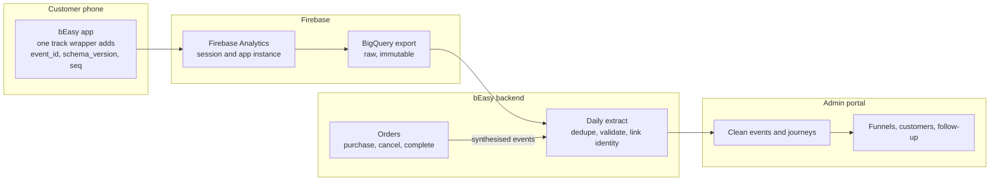

Three rules explain most of the numbers a marketer will see:

1. **The app reports what the customer did on screen. The backend reports what happened to the order.** Purchase, cancellation and completion never come from the app.
2. **Raw events are kept; clean events are counted.** Duplicates and invalid rows stay in the raw layer and are left out of every KPI.
3. **A person is only a *customer* after registration.** Before that they are an app instance, and their earlier activity is linked back afterwards (UC-08).

### Identity on every client event

| Field | Source | Meaning |
| --- | --- | --- |
| `event_id` | App | Unique id; the dedupe key |
| `schema_version`, `seq` | App | Contract version; order within a session |
| `user_pseudo_id` | Firebase | The app instance: the anonymous id |
| `user_id` | App, after `setUserId` | The customer id. Empty for guests |
| `ga_session_id` | Firebase | The session |
| `journey_id` | App | One service journey. Service and booking events only |
| `reg_flow_id` | App | One registration attempt. Registration events only |
| `service_id` | App | Stable key for the service. The name is display only |

Never sent: IDFA, Android advertising id, phone, email, street address. Location is `zone_id`, or `area_cell` (coordinates rounded to about 1 km) until the address API returns a zone. See [backend-request-journey-tracking.md](backend-request-journey-tracking.md).

---

## 2. Use-case index

| ID | Use case | Events (in order) | Feeds | Status |
| --- | --- | --- | --- | --- |
| [UC-01](#uc-01-app-open-and-campaign-attribution) | App open and campaign attribution | `app_opened` | Acquisition path, campaign table | Confirmed |
| [UC-02](#uc-02-browse-and-view-a-service) | Browse and view a service | `service_list_viewed`, `service_viewed` | Booking funnel step 1 | Confirmed |
| [UC-03](#uc-03-start-booking-and-fill-in-details) | Start booking and fill in details | `booking_started`, `address_selected`, option / duration / date / time events, `booking_details_completed` | Booking funnel steps 2 and 3 | Confirmed |
| [UC-04](#uc-04-choose-a-slot-review-and-apply-a-promo) | Choose a slot, review, apply a promo | `slot_selected`, `booking_summary_viewed`, `promo_applied` | Booking funnel step 4 | Confirmed |
| [UC-05](#uc-05-checkout-and-payment) | Checkout and payment | `checkout_started`, `payment_started`, `payment_failed`, then backend `purchase_completed` | Booking funnel steps 5 and 6, Follow-up | Confirmed; `payment_failed` proposed |
| [UC-06](#uc-06-after-the-purchase-cancel-or-complete) | After the purchase: cancel or complete | Backend `order_cancelled`, `service_completed` | Customers tab, status | Confirmed |
| [UC-07](#uc-07-registration-otp-then-sign-up) | Registration | `registration_started`, `otp_viewed`, `otp_verified`, `signup_viewed`, `registration_completed` | Registration funnel | Confirmed |
| [UC-08](#uc-08-anonymous-visitor-becomes-a-customer) | Anonymous visitor becomes a customer | `setUserId` + identity link | Every customer-level count | Confirmed |
| [UC-09](#uc-09-push-notification-opened) | Push notification opened | `push_opened` | Playbook attribution | Confirmed; ids pending. Not in demo |
| [UC-10](#uc-10-customer-has-turned-tracking-off) | Customer has turned tracking off | none | Data-quality panel | Confirmed |

| [UC-11](#uc-11-after-purchase-events-from-order-records-v21) | After purchase: payment retry, auto promo, reschedule, cancel with fee, refund | Backend order records | Acquisition "After purchase", event log | New in v2.1 |
| [UC-12](#uc-12-recovery-push-from-a-customer-list-v21) | Recovery push from a list or one customer | Backend send ledger, `push_opened` | Customer list, event log | New in v2.1 |
| [UC-13](#uc-13-cs-inbox-and-contact-log-v21) | CS inbox and contact log | Backend CS records | CS overview, Contacts tab | New in v2.1 |

Not separate use cases but part of the above: add-ons and pair services (`addon_*`, `pair_service_*`, `task_info_viewed`, `equipment_viewed`) belong to UC-03 and are **Not in demo**; `order_confirmation_viewed` (a UI screen, not the purchase record) belongs to UC-05 and is **Not in demo**.

---

## UC-01 App open and campaign attribution

**What the marketer learns:** which ad, deep link or push brought someone into the app, and how many of them went on to register and buy.

**Trigger:** the app becomes active (cold start, deep link, or push tap). An ad *click* is not an in-app event; tracking starts when the app opens.

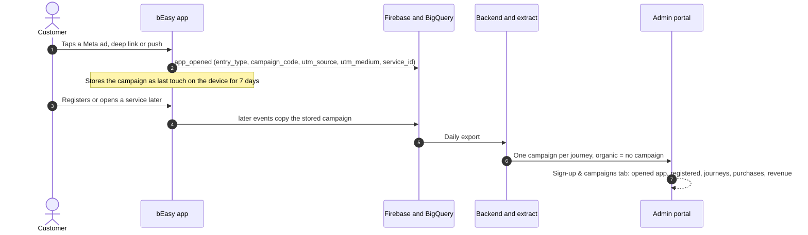

| Event | Required properties | Notes |
| --- | --- | --- |
| `app_opened` | `entry_type` (`organic` / `deeplink` / `push`) | Deep link or push also sends `campaign_code`, `utm_source`, `utm_medium`, `service_id` when known |

**Limits to state out loud:** one last-touch campaign per journey. This is not the automation guide's credit rule (coupon redemption, then last push open within 24 hours) and it is not holdout lift. Ad spend, CAC and ROAS are not in the data.

---

## UC-02 Browse and view a service

**What the marketer learns:** which services attract attention, before anyone has committed to anything.

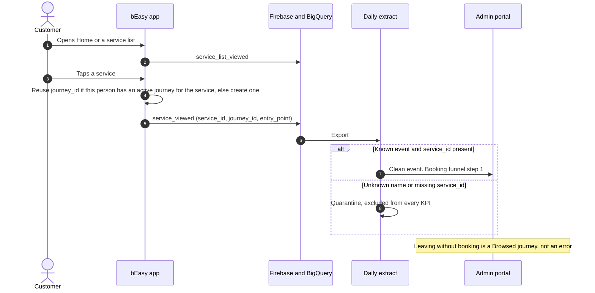

| Event | Required properties | Notes |
| --- | --- | --- |
| `service_list_viewed` | common only | Discovery volume. **Not in demo** |
| `service_viewed` | `service_id`, `journey_id`, `entry_point` (`home` / `search` / `banner` / `push` / `deeplink`) | Starts a journey |

**Journey rule:** the same `journey_id` is reused across sessions until purchase or 24 hours idle (`journey_idle_hours`). A session is not a journey and not a person.

**Do not confuse:** the *service views* count is events; funnel step 1 is **unique journeys** (or customers) that reached `service_viewed`.

---

## UC-03 Start booking and fill in details

**What the marketer learns:** whether the booking form itself loses people, before they ever see a price or a slot.

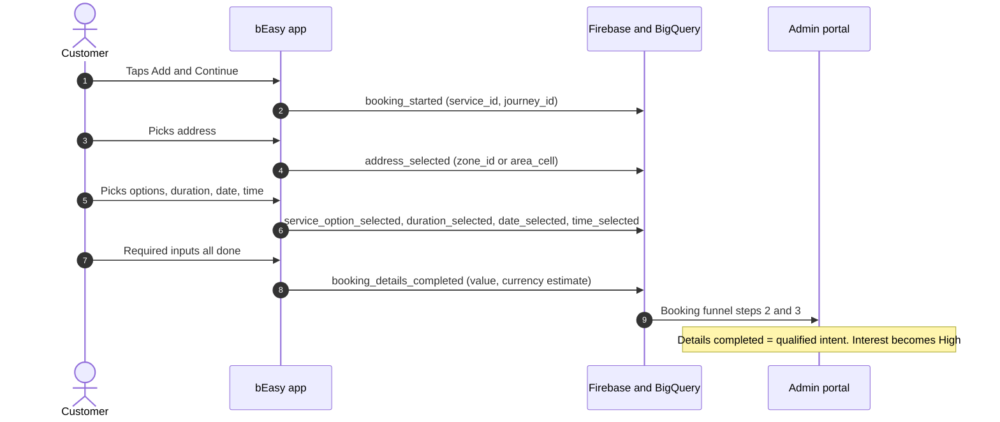

| Event | Properties | Funnel role |
| --- | --- | --- |
| `booking_started` | `service_id`, `journey_id` | **Step 2.** Fires at the start of booking, not at the payment sheet. Interest: Medium |
| `address_selected` | `zone_id` or `area_cell`. Never a street or address-row id | Not a stage. Zone for later supply checks |
| `service_option_selected`, `duration_selected`, `date_selected`, `time_selected` | option ids; `duration_hours`; `slot_date`; `slot_time` | Not stages. They explain *why* details are not completed |
| `booking_details_completed` | `value`, `currency` (estimate) | **Step 3** |

**Missing middle event:** if a later step exists but an earlier one is missing, the funnel still counts the earlier step and marks it *imputed*, so the funnel never goes backwards. The skip is shown, not hidden.

---

## UC-04 Choose a slot, review, apply a promo

**What the marketer learns:** whether availability or price is the friction, and whether promo codes are being tried and failing.

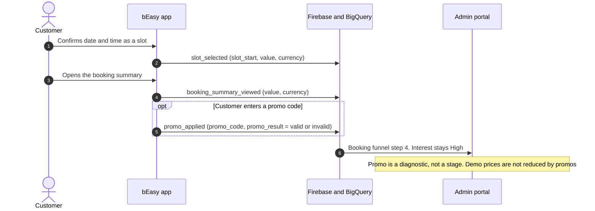

| Event | Properties | Funnel role |
| --- | --- | --- |
| `slot_selected` | `slot_start` (ISO-8601 with offset), `value`, `currency` | **Step 4.** High intent |
| `booking_summary_viewed` | `value`, `currency` | Not a stage |
| `promo_applied` | `promo_code`, `promo_result` | Not a stage. Repeated `invalid` is an abuse signal |

---

## UC-05 Checkout and payment

**What the marketer learns:** the most valuable number on the page. These are people who were one tap from buying. Support can help the ones whose payment failed; a reminder helps the ones who simply left.

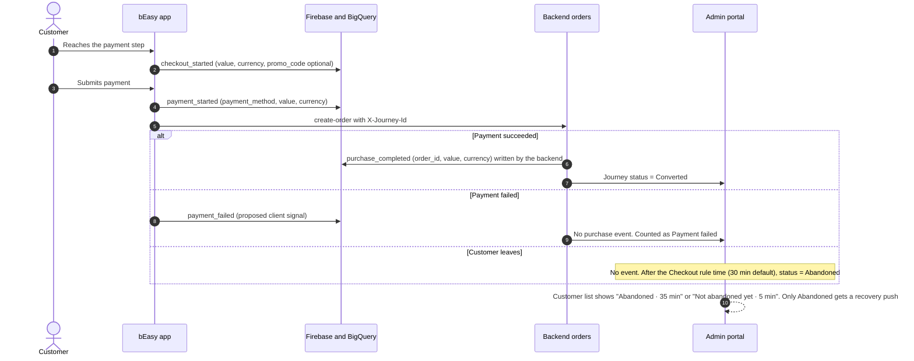

| Event | Owner | Properties | Funnel role |
| --- | --- | --- | --- |
| `checkout_started` | App | `value`, `currency`, optional `promo_code` | **Step 5.** Very high intent. Leaving here is checkout abandonment, not a failed payment |
| `payment_started` | App | `payment_method`, `value`, `currency` | UI signal. The order row is the payment result |
| `payment_failed` | App signal + **Backend** payment record | `payment_method`, `error_code` (new) | **v2.1: needed.** Starts the *Payment failed* abandon rule (30 min, no successful retry) and the *Payment failed, then paid* line. The backend payment record is the truth; the backend already accepts the event name. Does not create a purchase |
| `purchase_completed` | **Backend** | `order_id`, `value`, `currency` | **Step 6.** Source of truth. The app must not emit it |
| `order_confirmation_viewed` | App | UI only | **Not in demo.** Not the purchase record |

**Why two purchase numbers can differ:** *Bookings* (Overview) counts succeeded orders by **payment time**. The funnel purchase step counts journeys that **started** in the period and reached purchase. Both are correct; they answer different questions.

---

## UC-06 After the purchase: cancel or complete

**What the marketer learns:** whether bookings turn into delivered service, and which customers should enter a repeat or review journey instead of an acquisition one.

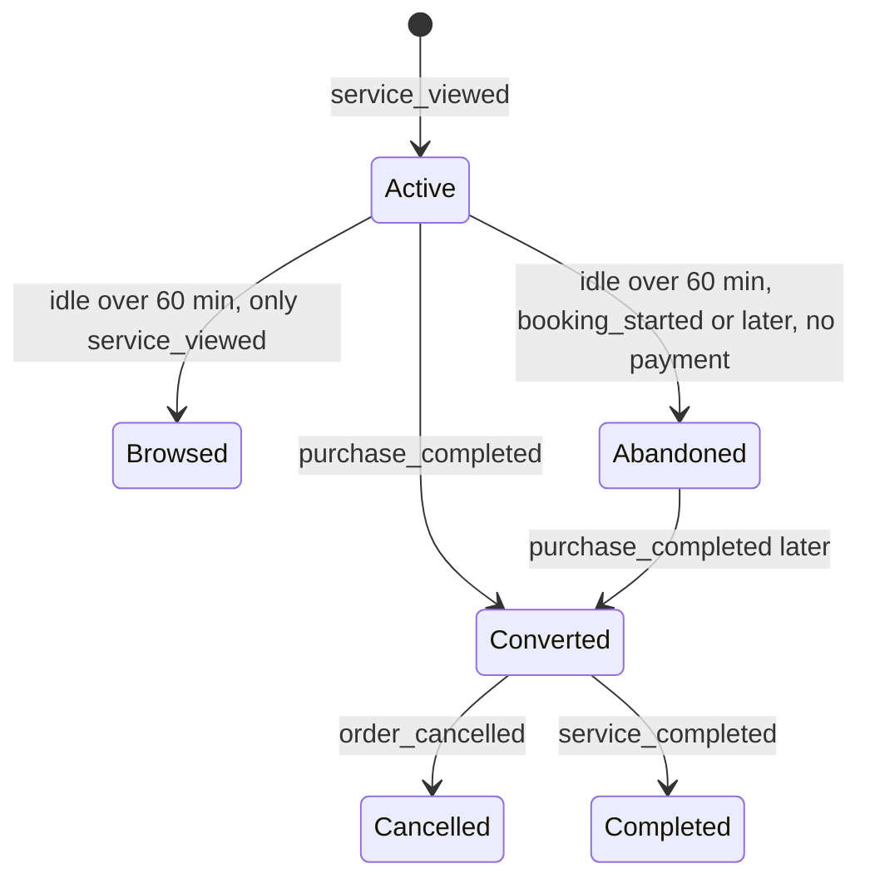

| Event | Owner | Properties | Effect |
| --- | --- | --- | --- |
| `order_cancelled` | **Backend** | `order_id`, `value` | Status becomes Cancelled. The funnel still counts the purchase. Not a new lead: route to Support |
| `service_completed` | **Backend** | `order_id`, `value` | Status becomes Completed. Feeds repeat and review flows |

Timestamps after the reporting time are ignored, so a future completion never appears early.

### Journey status, calculated not emitted

| Status | Rule | Source |
| --- | --- | --- |
| Active / Not abandoned yet | No terminal state and idle less than the rule time for the furthest step | **v2.1:** per-step rules replace the single 60 minutes |
| Browsed | Idle after only `service_viewed` | **v2.1 open (N3):** covered by the *Viewed, didn't book* rule (24 h); likely dropped as a separate status |
| Abandoned | Furthest step has no next step and idle ≥ rule time: Viewed 24 h, Booking 1 h, Details 1 h, Slot 1 h, Checkout 30 min, Payment failed 30 min | Admin setting, "Abandon rules". Purchase clears it at once. Rule changes apply from now on |
| Converted | Payment succeeded, not yet completed or cancelled | Backend order |
| Cancelled / Completed | Those timestamps are at or before the reporting time | Backend order |

---

## UC-07 Registration: OTP, then sign-up

**What the marketer learns:** whether people give up at the OTP code or at the profile form. These need different fixes (SMS delivery vs. form length), so they are separate stages.

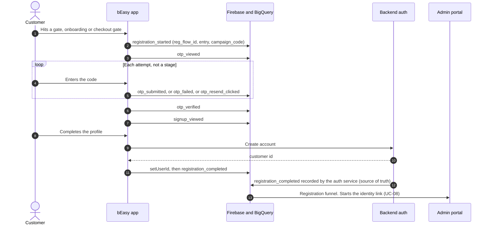

| Stage | Event | Properties |
| --- | --- | --- |
| 1 | `registration_started` | `reg_flow_id`, `entry` (`gate` / `onboarding` / `checkout_gate`), `campaign_code` |
| 2 | `otp_viewed` | `reg_flow_id` |
| not a stage | `otp_submitted`, `otp_failed`, `otp_resend_clicked` | `attempt_no`, `error_code` |
| 3 | `otp_verified` | `reg_flow_id` |
| 4 | `signup_viewed` | `reg_flow_id` |
| 5 | `registration_completed` | customer id after `setUserId` |

**v2.1 stage names and sources.** The UI uses: Registration page viewed (`registration_started`) → **OTP requested** (backend `OTP_SENT` from the send-OTP call; this is where the phone number is saved) → OTP verified → Sign-up started (`signup_viewed`) → Registration completed. `otp_viewed` is diagnostic.

**Why OTP fails.** For flows with OTP requested and no verify: *SMS not delivered* and *API / gateway error* come from the SMS gateway response, stored by the backend with the gateway code; *wrong code* and *blocked after 3 tries* come from `otp_failed` (`error_code` = `wrong_code` / `blocked`, with `attempt_no`); *expired or left* is the remainder. Each reason opens the people, with masked phone, device, app version, source and resend count. The people are not registered: export, share with Tech, CS inbox and ad audience only.

**Reading it:** a drop between stage 2 and 3 is OTP friction. A drop between 4 and 5 is the sign-up form. The registration funnel ignores the service filter and says so. Keep it out of the booking funnel.

**Acquisition can go up:** a returning customer may book without starting registration in the period, so a later acquisition step can be larger than the one before it. The portal shows that increase instead of hiding it.

---

## UC-08 Anonymous visitor becomes a customer

**What the marketer learns:** the complete path from ad to first booking, even though the customer was a stranger for the first minutes of it.

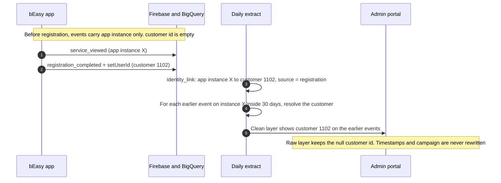

| Question | Answer |
| --- | --- |
| How far back does linking reach? | 30 days before the link (`link_window_days`) |
| Is anything overwritten? | No. Original timestamps, source, campaign and service are kept. The raw layer still shows the null customer id |
| What if the person never registers? | Events stay anonymous. They count in people and sessions, not in customer counts |

Worked example: customer `1102`, journey `journey-story-checkout`. They view Instant Cleaning at 10:03, register at 10:06, and the 10:03 view still belongs to customer `1102` in the clean layer.

---

## UC-09 Push notification opened

**What the marketer learns:** which automated message a customer responded to, so a playbook can be credited with the order.

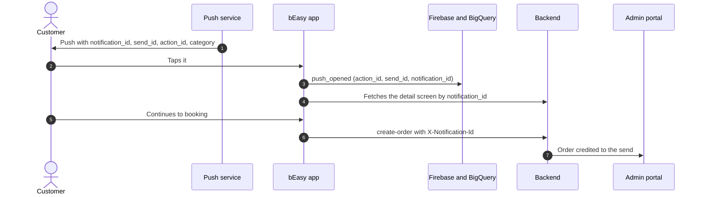

**Current gap:** today's pushes do not carry those ids, so `push_opened` is incomplete until the backend adds them. **Not in demo.** Credit rule and measurement are in [bEasy-automation-engagement-guide.md §9.5](../architecture/bEasy-automation-engagement-guide.md#95-attribution-rule-one-precedence-written-down).

---

## UC-10 Customer has turned tracking off

**What the marketer learns:** how many people we cannot see, so a low count is not mistaken for low interest.

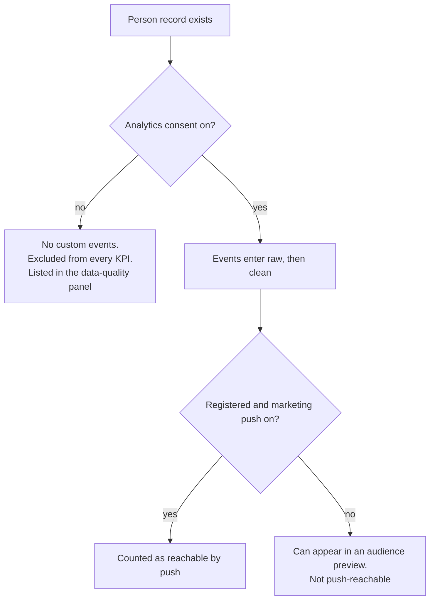

Guests are never push-reachable in this prototype. ABA Mini App users have no push token; that channel is out of scope. The demo customer `1999` has `analyticsConsent: false` and no events.

---

## UC-11 After purchase: events from order records (v2.1)

**What the marketer learns:** whether the orders from a campaign pay, stay and get completed, and what happens to the money.

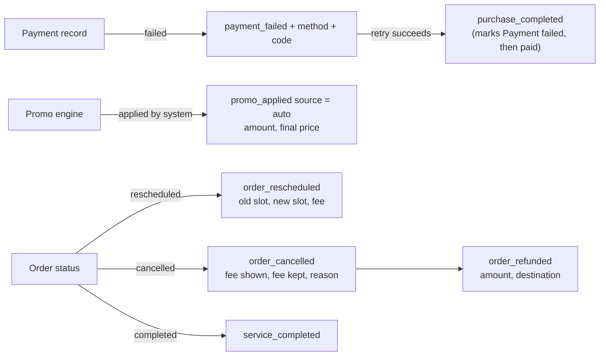

All of them are written by the backend from order and payment records, never from screen events. The client may add diagnostics: `reschedule_started`, `cancellation_started`, `cancellation_fee_shown`. The backend currently skips `order_rescheduled` sent by the app; with v2.1 the backend must write its own. New backend event types needed: `payment_failed` (with retry linkage), `promo_applied` with `source` (auto / manual), `order_rescheduled`, `order_refunded`; `order_cancelled` gains `fee_amount`, `fee_kept`, `reason`.

## UC-12 Recovery push from a list or one customer (v2.1)

```mermaid
sequenceDiagram
  autonumber
  actor S as Marketing
  participant PO as Admin portal
  participant BE as Backend decision service
  participant OR as Orders
  participant App as Customer app
  S->>PO: Footer "Send push" on a Dropped list
  PO->>BE: preview (list query, selection)
  BE-->>PO: will get it, weekly limit, just bought, not abandoned yet, push off, guests
  S->>PO: Confirm (English and Khmer text, no promo, now or schedule)
  PO->>BE: send
  BE->>OR: re-check orders and Abandoned status
  BE->>App: push with notification_id, send_id, deep link to the unfinished checkout
  App->>BE: push_opened, then booking
  BE-->>PO: event log row "Recovery push sent"; buyer leaves the recovery list
```

Safety checks run at send time, not only at preview. The weekly marketing limit is shared with all other marketing pushes (value to confirm). A customer who books in between is removed automatically.

## UC-13 CS inbox and contact log (v2.1)

```mermaid
sequenceDiagram
  autonumber
  actor M as Marketing or CS
  participant PO as Admin portal
  participant BE as Backend CS service
  actor A as CS agent
  M->>PO: "Send to CS inbox" (reason, due, priority, note)
  PO->>BE: create cases (suppressed people left out)
  A->>PO: Picks a case up
  BE-->>PO: Owner = first agent to pick it up
  A->>PO: Taps Call, then "How did the call go?"
  PO->>BE: contact (channel, result, said, problem, purpose)
  BE-->>PO: CS overview: picked up, attempts → reached, problems found; first sale joins by order records
```

Only sales follow-ups count as CS contact for sales results. Orders and revenue come from bookings and payments, never from the form. "Asked for no more calls" suppresses the customer.

---

## 3. Behind the scenes: from raw event to clean number

This is what happens to every event between the app and a portal tile.

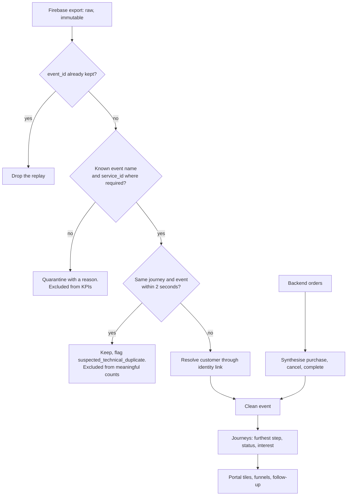

| Check | Rule |
| --- | --- |
| Duplicate delivery | Keep the earliest row per `event_id` |
| Unknown name (for example legacy `view_content`) | Backend skips it without quarantine (agreed). The portal prototype still quarantines it as `unknown_event_name` |
| Service event without `service_id` | Quarantine as `missing_service_id` |
| Double fire | Same journey and event name within 2 seconds is flagged, not counted |
| Meaningful counts exclude | Quarantined rows, technical duplicates, proposed events, `app_opened` |
| Offline device | Firebase buffers and delivers later. No custom on-device queue is specified, so the prototype models only the server-side rules |

---

## 4. Cross-cutting definitions

### Session, journey, person

| Thing | Identified by | Lasts |
| --- | --- | --- |
| Person | `user_pseudo_id`, then customer id after registration | Until app reinstall (guest) or forever (customer) |
| Session | `ga_session_id` | One app visit. The sessions KPI counts distinct ids on clean events |
| Journey | `journey_id` | One service, reused across sessions until purchase or 24 hours idle |
| Registration attempt | `reg_flow_id` | One pass through the sign-up flow |

### Funnel arithmetic

- Step conversion: `count[i] / count[i-1]`.
- Drop-off sits on the step being left: `count[i] - count[i+1]`, divided by `count[i]`.
- Median minutes use the first meaningful event of each step, on journeys that reached the later step. Missing events are left out of the timing sample, never treated as zero.
- The portal's **Biggest booking leak** looks only after "Booking Started", because most visitors only browse and that loss is expected.

### From journey to action

How a journey turns into a marketing or support action. Thresholds are the spec's starting point and are configurable.

| Journey situation | Interest | Suggested action | Do not |
| --- | --- | --- | --- |
| Checkout started, no purchase, within 24 hours | Very high | Immediate reminder push that opens the exact service | Keep pushing after an order exists |
| Details or slot chosen, within 7 days | High | Push with deep link; Support call for high-value cases | Send unrelated services |
| Booking started, no details | Medium | Continue-booking push | Offer a discount yet |
| Viewed only, repeated sessions | Low to medium | Benefit or proof message | Aggressive discount |
| Payment failed | n/a | Support contact | Discount |
| Cancelled | Post-purchase | Support recovery | Treat as a new lead |
| Completed | Post-purchase | Review, repeat reminder | Acquisition push |

---

## 5. Open questions

| # | Question | Where it matters |
| --- | --- | --- |
| 1 | Whitelist `payment_failed`, or derive failure from the order only? | UC-05 |
| 2 | ~~Keep or quarantine the ~40 legacy events?~~ Resolved: the backend skips them | Section 3 |
| 3 | When will the address API return `zone_id`? Not planned for now; the app sends `area_cell` and the backend keeps it in metadata | UC-03 |
| 4 | Add `notification_id`, `send_id`, `action_id` to pushes? Deferred to the notification phase | UC-09 |
| 5 | ~~Is the abandonment clock 30 or 60 minutes?~~ Resolved in v2.1: one rule per step (Viewed 24 h, Booking 1 h, Details 1 h, Slot 1 h, Checkout 30 min, Payment failed 30 min) | UC-06 |
| 6 | Is the backend, or the client, the source of truth for `registration_completed`? Both emit it | UC-07 |
| 7 | Guest events are skipped by the importer, but v2.1 shows devices (matrix N1) | UC-07, UC-08 |
| 8 | Whitelist banner / search / reschedule-started / cancellation events (matrix N5) | UC-11 |
| 9 | Clarity session mapping (matrix N6) | Customer page |
| 10 | Weekly push limit, interest thresholds, CS targets, AI summary model (UI Flow section 9) | UC-12, UC-13 |
