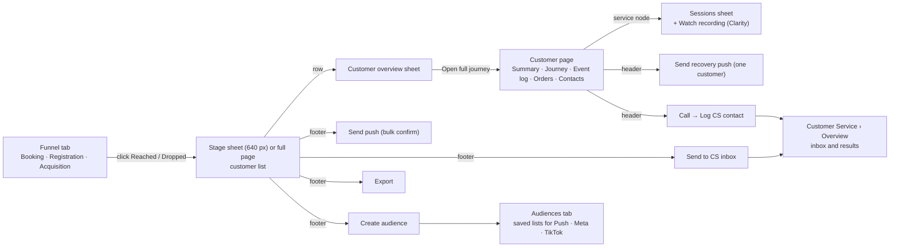

# Customer Journey — UI/UX flow v2.1 (after business review, 7 Oct 2026)

Canonical description of the approved admin UI. Every other tracking document links here for screen behaviour and carries only the data, backend and portal consequences.

| | |
|---|---|
| Source | Figma file `8bDJcg0dDmieddfLLjkloh`, section **Customer Journey v2.1 — Handoff (after biz review 7 Oct)**, node `1:597` |
| Read on | 8 Oct 2026, from the text layers of the section (about 5,900 text nodes, 40 screens). Visual details that are not text (colour, spacing, arrow routing) were not reviewed |
| Data in the file | Sample data only. Numbers match across screens, but they are not targets or benchmarks |
| Supersedes | The Overview / Booking / Sign-up / Customers / Follow-up / Audiences tabs of the `draft/tracking` prototype (see [Journey_Tracking_Implementation_Report.md](../../v1/Journey_Tracking_Implementation_Report.md)) and the `/funnels` + `/audiences` page sketches in `bEasy-portal/TODO.md` before 8 Oct |

Related: [Journey_Tracking.md](Journey_Tracking.md) (business spec, updated), [Journey_Tracking_Analytical_Model.md](../architecture/Journey_Tracking_Analytical_Model.md) (metric definitions), [Journey_Tracking_API_Contract.md](../archive/Journey_Tracking_API_Contract.md) (endpoints), [Journey_Tracking_Requirements_Matrix.md](Journey_Tracking_Requirements_Matrix.md) (traceability and conflicts), `bEasy-portal/TODO.md` (build plan).

---

## 1. The idea in one line

Go from a number to the people behind it, and act:

**Funnel → Stage (Reached / Dropped) → Customer list → Customer → Journey → Session / Event log → Action (push, CS inbox, export, audience).**

"Green arrow = staff action, starting from the element that triggers it" is the Figma convention for every flow diagram in the file.

## 2. Navigation and page map

| Area | Where | Notes |
|---|---|---|
| Customer Journey | Sidebar **Marketing › Customer journey**. Breadcrumb `Marketing / Customer journey`. Header "See where customers stop, who they are, and what to do next." | Four tabs: **Booking funnel** (default), **Registration funnel**, **Acquisition funnel**, **Audiences** (badge with the saved count) |
| Abandon rules | Link on the funnel card and on every list strip ("Rule · Edit") | Admin only. Settings screen, see 5.6 |
| Customer page | `Customers / <name>` | Tabs: **Summary · Journey · Event log · Orders · Contacts**. Opens from any list row (lands on Journey) |
| CS overview | Sidebar **Customer Service › Overview**, breadcrumb `Customer Service / Overview` | New page: today's inbox on top, monthly results below |
| States | One reference screen "states & edge cases" | Loading, empty, blocked, partly allowed. Acceptance list for the portal |

The mock sidebar inside the frames repeats some items (Customers, Service Bundle, Top Up…) under Marketing. Treat it as placeholder: only **Customer journey** under Marketing and **Overview** under Customer Service are new.

## 3. Shared layout of the three funnel tabs

Header + tabs → filter bar → 4 KPI cards → funnel card → drop-off table → extra sections.

| Element | Behaviour |
|---|---|
| Filter bar | Five controls, left to right: **Date** (presets Today, Last 7 / 30 / 60 / 90 days, Custom range; range calendar; the footer shows the picked range and "Compared with <previous range>"; the **previous period is always compared**, there is no toggle), **Service** (searchable, several allowed, counts, Clear / Apply), **Customer** (All types · Registered, no order yet · Existing customer · Guest · Saved segment…), **Source / campaign** (searchable, grouped Meta / TikTok / Other, several allowed, counts, Clear / Apply), **Device** (All devices · Android app · iPhone app · Web, with counts). Menu counts follow the other filters. Active filter = brand border + **Clear filters** (Figma node `9:11043`, menus `9:39331`, `9:39375`, `9:39425`) |
| KPI cards (booking) | Customers who viewed · Purchased · **Recoverable now** (with open value) · **Biggest drop** |
| Funnel card | Dotted canvas, one card per stage: icon, title, "Stage n of N", % of first stage, **Reached** button, **Dropped here** button. Rate pill between cards = share that continued. Toolbar, **Full screen**, "Abandon rules" link. Insight line: "Biggest drop: 580 of 1,000 customers (58%) viewed a service but never started a booking." |
| Drop-off table | Stage · Reached · Continued · Dropped here · Suggested next step. Same numbers as the cards. Blue (Reached) and red (Dropped) numbers open the list |
| Counting mode | The **Customers / Journeys** toggle sits in the funnel card header next to "Abandon rules" and "Full screen" (registration: People / Devices). Booking default counts **customers**; **Journeys** counts one customer once per service visit. A banner says which mode is on. Lists always show people |

### 3.1 Booking funnel

Six stages: **Service viewed → Booking started → Details completed → Slot selected → Checkout started → Purchased**. Sample: 1,000 → 420 → 269 → 210 → 160 → 110. Suggested next steps per row: retarget viewers with ads · push: continue booking · high-intent reminder · reminder with their slot · recovery push, no discount · move to repeat / cross-sell.

Customer-type menu sample: All 1,000 · Registered, no order yet 570 · Existing customer 310 · Guest 120 (shown as devices) · Saved segment (opens a CRM segment picker).

### 3.2 Registration funnel

"Where people get stuck creating an account — separate from booking problems." Counted as **People / Devices** (toggle), because before sign-up a person is a device.

Five stages: **Registration page viewed → OTP requested → OTP verified → Sign-up started → Registration completed**. Sample: 3,000 → 2,400 → 1,900 → 1,750 → 1,520.

Extra section **Why OTP fails** for the people who requested an OTP and never verified: SMS not delivered (180) · API / gateway error (60) · Wrong code entered (120) · Blocked after 3 wrong tries (40) · Code expired or left (100). Delivery and API errors come from the SMS gateway; wrong code and blocked come from the app. Each row opens the people.

Insight line example: "500 of 2,400 asked for an OTP but never verified it. That points to an OTP delivery problem, not price or booking."

### 3.3 Acquisition funnel

"From ad click to first purchase." Nine stages: **Ad clicked → App opened → Registered → Service viewed → Booking started → Details completed → Slot selected → Checkout started → Purchased**, plus an **After purchase** phase.

| Rule | Detail |
|---|---|
| Ad clicked | Meta total only. Locked: not a link, no list. The stage-sheet state says "Meta reports this number — people can't be listed", and points to App opened or a Meta lookalike |
| From App opened on | Every Reached / Dropped opens a list. Before sign-up the rows are **devices** (device ID, app version, sessions, where they stopped) |
| Filters | Channel, Campaign, Ad set, Service, Customer (new vs existing), date |
| After purchase (from **order records**, not screens) | Payment failed, then paid (retried within 30 min) · Auto promo applied (vs manual codes) · Rescheduled (done / upcoming / paid a fee) · Cancelled (with fee, kept $ / free) · Refunded ($ back to the original payment) · Service completed (% of purchases, orders still upcoming). Numbers open the orders |
| Compare campaigns | Campaign · Ad clicks · App opens · Registered · Purchased · Click → buy. A row loads that campaign's funnel above |

## 4. Customer list (stage sheet)

Any Reached or Dropped number opens a **640 px sheet** on the right over a dimmed page. **Open as page** shows the same list full-page.

| Part | Behaviour |
|---|---|
| Header | "`<Step>` · Dropped here / Reached", definition, date range and active filters, source. Count + unit (customers, people, devices). **Reached / Dropped** switch |
| Abandoned strip (booking) | "46 abandoned (no payment for 30 min+) · 4 still inside 30 min — not abandoned yet" + **Rule · Edit** (admin) |
| Reach tiles | **Push** · **CS contact** (phone only, push off) · **Ads only** (guests / devices). They add up to the list count. Suppressed people stay in the list, tagged, and are left out of push / CS / audiences |
| Row | Name or masked phone, device + app version, status tag (**Abandoned · 35 min** red, **Not abandoned yet · 5 min** grey), furthest step, service, source / campaign, interest level, reach, open value, last activity. Registration rows add OTP result badge, gateway code, lock, resend count |
| Search | Inside this list only, by name or phone |
| Selection | "All 50 selected" by default. Footer shows real reach |
| Footer | **Export** · **Send to CS · n** · **Send push · n** · **Create audience** |

Footer states (never show an action people can't receive; hide it and say why):

| Selection | Footer |
|---|---|
| Mixed (default) | Every action shows how many people it really reaches |
| Guests only | Push and CS hidden. Export + ad audience |
| Push off for all | Send push hidden. CS call is the way |
| Nothing selected | Actions visible but disabled, with a hint |
| **Reached** view | Push and CS hidden, with the reason ("110 of these already bought. Switch to Dropped here") |
| Registration dropped list | Phone is saved at the OTP request. Actions: Export, **Share with Tech**, Send to CS inbox, Create ad audience. **No push** (not registered) |
| Acquisition devices | Not registered: no push, no CS call. "Use them as a Meta retargeting audience" |

Page filters (date, service, customer type) are carried into the sheet and shown as "Filters from the page".

## 5. Actions

### 5.1 Bulk recovery push (confirm dialog)

"Checkout started · Dropped here · Last 30 days". Funnel of eligibility, all computed server-side:

| Line | Meaning |
|---|---|
| **24 will get it** | Push on, no order since, under the weekly push limit |
| −4 skipped | Weekly push limit (already 3 marketing pushes this week; value to confirm) |
| −2 removed | Just bought. Orders re-checked "a moment ago" |
| −1 not abandoned yet | Still inside the checkout window. Waits |
| 12 not included | Push off → use "Send to CS inbox" |
| 7 not included | Guests |

Message preview uses `{service}` and `{slot}` per person, opens the unfinished checkout, **no promo by default**, **Send now / Schedule**, and "Edit in Push Notifications" (opens the full tool pre-filled). "Right before sending we check orders again — anyone who books in the meantime is dropped automatically." After sending: toast "Recovery push sent to 24 customers · 6 skipped" and the button becomes "Push sent · 24" (disabled). Opens and bookings appear in each customer's event log.

Recovery push goes **only to Abandoned** people, never to "not abandoned yet".

### 5.2 Send to CS inbox

No person picker. Fields: **Reason** (Sales follow-up / Help with a booking), follow up by, priority, note. Suppressed people are left out. "Whoever picks a case up owns it to the end"; picked-up and closed cases count toward that person's results. **Only sales follow-ups count in the CS overview.** A call to confirm an existing booking is not a sale. Result: toast, and "Waiting in CS inbox" goes up.

### 5.3 Export

Choose columns: Name and phone · Customer ID / device ID · Service · Furthest step and last activity · Open value · Source / campaign · Interest level · Reachability (push · CS · ads) · Session IDs. Guests export a device ID instead of a phone. Suppressed people are included and marked **do not contact**.

### 5.4 Create audience

Opens the Audiences builder pre-filled with the list's rules (5.7).

### 5.5 One customer: recovery push and log contact

**Send recovery push (customer page):** write both **English and Khmer**, each customer gets theirs. Preview, title, message with their service and slot, deep link to their unfinished checkout, **promo off for a first reminder**. "Checked before sending": no order since checkout, push on, not suppressed, under the weekly limit (1 of 3 this week).

**Log CS contact (after tapping Call):** "Tapping a number alone doesn't count as a call." Fields:

| Field | Values |
|---|---|
| Channel | Phone call · Telegram · In-app chat |
| Result | No answer (attempt) · Busy, call back later (attempt) · Spoke to the customer (reached) · Wrong number (flags the phone for CS to check) |
| What did they say? (optional) | Will book later · Booked now · Needs price info · Not interested · **Asked for no more calls** (adds to Suppressed customers) |
| **Found a problem?** | Payment problem · App bug · Price or slot · Partner issue · None. Counts toward the CS KPI |
| Purpose | Booking confirmation, sales follow-up… |
| Next follow-up, note | |

Orders and revenue never come from this form. They come from bookings and payments.

### 5.6 Abandon rules (admin settings)

"How long someone can stay at a step before they count as abandoned."

| Rule | Condition | Default |
|---|---|---|
| Viewed, didn't book | Service viewed · no Booking started | 24 h |
| Booking abandoned | Booking started · no Details completed | 1 h |
| Details abandoned | Details completed · no slot picked | 1 h |
| Slot abandoned | Slot selected · no checkout | 1 h |
| Checkout abandoned | Checkout started · no payment | 30 min |
| Payment failed | Payment failed · no successful retry | 30 min |

**Dropped here** is reporting: reached a step in the date range and didn't reach the next. **Abandoned** is a CRM action status: no next step after the time above. Only abandoned people get recovery pushes or CS follow-up. A purchase removes the status at once. Changing a rule updates lists, audiences and push eligibility **from now on**. Funnel counts do not change, because they follow the date range.

### 5.7 Audiences tab

"Saved lists for Push, Meta and TikTok — built from a funnel list. Counts refresh daily; people who buy drop out on their own. Saving never sends anything."

| Part | Behaviour |
|---|---|
| Saved audiences table | Audience · Built from (e.g. "Booking funnel → Checkout started") · People · Push · Ads · Updated · Status (**Synced / Syncing… / Meta sync failed + Retry**). Header "4 audiences · Meta syncs once a day" |
| New audience (from a funnel list) | Banner says where it started, e.g. "Booking funnel → Checkout started → Dropped here · 50 people · Sep 8 – Oct 7. 3 suppressed customers are left out." Rules read **Field · Operator · Value**; rules from the funnel are locked ("From funnel"); AND rows, one OR group, Exclude rows |
| Rule types | Journey step · Behaviour (HAS / HAS NOT) · Service · Source / campaign · Customer type · Saved segment · Order count · Last order · Date (WITHIN / BEFORE / AFTER) · How often (EXACTLY / AT LEAST / AT MOST) |
| Estimated size | Updates live: people, reach bar, Left out (suppressed), Will be available in (Push · 31, Meta ads · up to 47) |
| Make available in | **Push campaign** (registered, push on; message is written later in Push Notifications) · **Meta ads** (Custom Audience, matched by phone or device, syncs daily) · **TikTok** (not connected → disabled, link to Setup) · **Export CSV** |
| Name | Must be unique; checked as you type; Save disabled until unique |
| **Templates** | **Hidden** after the review (overlap with CRM segments and dynamic push). Frame `1:27128` still shows the template cards: ignore them |

## 6. Customer page

Header: avatar, name, journey-status badge, phone · ID · customer since · came from (campaign) · **device (OS + app version)**; buttons **Call** and **Send recovery push**.

| Tab | Content |
|---|---|
| Summary / overview sheet | KPIs: furthest step · interest (+ change) · open intent value · lifetime spend. **AI summary**, "Journey at a glance" (per service: stopped at checkout 5/6, stopped at slot 4/6, purchased 6/6), numbers (sessions 30 days, last active, push this week 1 of 3, best channel), recent activity |
| **Journey** (default) | **AI summary** card: What happened · Next step · Best offer · "Written today 10:05 AM · Refresh" · "Write push from this (English / Khmer)". **Journey canvas**: source → one node per service → furthest step → after purchase (service completed / order cancelled). Toolbar: select, pan, zoom, Fit, **Full screen** (minimap, Esc exits). Click a service node → **sessions sheet** |
| Sessions sheet | Stepper (Viewed · Booking · Details · Slot · Checkout · Purchase), stats (sessions, latest value, slot picked, came from), sessions newest first, each with status and **Watch recording ↗** (Microsoft Clarity, linked by session ID) |
| **Event log** | Every event in exact time order, grouped by day then session; session header: service, time, events, entry, furthest step, status, Watch recording. Columns **Time · Event · Service · Details · Source / campaign · By** (App / Backend / System / Meta / team). Expand a row for Event ID, Session ID, Device, Campaign ID, Deep link. Filters: date, service, event, journey status, source. Opens filtered from the canvas ("Instant Cleaning · 9 events · 3 sessions"), or "all services" |
| Orders | Orders of this customer (post-purchase history) |
| Contacts | CS contact log (calls, Telegram, chat) and pushes sent |

Event log content required by the review: ad click (campaign, creative), first open (new install, from ad), guest device activity **merged at sign-up** ("Phone + OTP · anonymous activity merged into this customer"), banner clicked, search performed, search result clicked, service and booking events, promo applied (**auto vs manual**, amount, final price), payment failed → retried with another method, purchase completed (amount, method, order source), reschedule started (App) / completed (old → new slot, fee, "1st free change"), cancellation started / fee shown / order cancelled (fee kept, reason), refund completed (amount, destination), service completed, recovery push sent (team), push opened.

## 7. CS Overview (Customer Service › Overview)

"First sales, repeat sales and follow-up work — worked out from contacts, bookings and payments. No monthly report to prepare."

| Section | Content |
|---|---|
| Provisional banner | "214 customers who registered after Sep 7 are still inside their 30-day window. Results can still change" |
| **Today's follow-up work** | Live inbox, kept apart from the monthly results. Per CS employee: **Picked up** (reg · existing) · Not contacted · Due today · Overdue · On time % · Attempts → reached. Team total counts each customer once. "Unavailable" means outcomes were not recorded (not the same as 0). Waiting in CS inbox count |
| **Problems found by CS this month** | payment · app bug · price or slot · partner, "counts for **5% of the CS KPI**", link to the list |
| **First sales — registered customers** | Same registration group and a **30-day window** for both sides. *Contacted by CS* (registered, contacted before first purchase) vs *No CS contact* (bought in the app on their own): customers, with a first sale, conversion, revenue. By employee: contacted · first sale · conversion · revenue · **vs target 30%**. Footnote when 10 customers were contacted by two people (rows add up to more than the team total). Each sale is credited to the **last sales follow-up before the order** |
| Other sales without CS contact | Telegram, walk-in, partner referrals. Kept apart from app self-conversion |
| **Repeat sales — existing customers** | Followed up · Ordered again · Repeat conversion · Repeat bookings · Repeat revenue, per employee; 30-day window; extra calls in the same window don't count the same order twice. N/A when there is nobody to divide by |
| Definitions | Revenue = completed service after discounts and refunds, without tax. Deposits alone are not full revenue. "This compares sales with and without recorded CS contact. It doesn't prove the call caused the sale." A booking-confirmation call after purchase does not count as CS contact |

Every number opens its customers, cases or orders.

## 8. States and edge cases (acceptance list)

| Where | State | Behaviour |
|---|---|---|
| Funnel | Loading | Skeleton with the same layout. Filters stay usable |
| | Couldn't load | "Couldn't load the numbers. Check your connection and try again. Your filters are kept." One retry |
| | No data for the filters | All stages 0. Say why and give the two likeliest fixes ("Nobody matched Sep 8 – Oct 7 with Service: Sofa Cleaning and Source: TikTok") |
| Stage sheet | List loading | Header, counts and reach tiles first; rows are skeletons |
| | Nobody stopped here | Dropped = 0. Hide the footer actions |
| | Search no match | "No one matches 'Sreyneang'. Search by name or phone. The person may be in another stage" |
| Acquisition | Stage can't be listed | Ad clicks: lock, point to the next stage |
| Footer | Mixed, guests only, push off for all, nothing selected | See section 4 |
| Audience | Name already used | Save disabled until unique |
| | Meta not connected | Channel stays visible, cannot be ticked, "Ask an admin to connect it in Setup → Integrations" + **Connect** |

## 9. Dev notes and open questions from the file

Dev notes (verbatim intent):

1. Purchase, payment failed, cancellation (+ fee), refund, reschedule and service completed come from **backend order records, never from screen events**.
2. Statuses are **derived, not fired**. Abandoned = last step + no next step within the rule time for that step (admin config). Purchase removes it immediately.
3. OTP errors: delivery and API errors from the SMS gateway responses; wrong code and blocked from app events. **Phone captured at OTP request.**
4. Device per user from app data / Google Analytics (OS, app version). Guest devices are merged on sign-up and login.
5. AI summary is generated from the event log per customer, with a Refresh. The push suggestion is a draft only.
6. Clarity: each session links to its recording by session ID.
7. Push send re-checks orders and Abandoned status right before sending. Weekly marketing limit (3 per week shown, to confirm).
8. CS inbox: case owner = first person to pick it up. Results and "problems found" count by owner.

Open questions (owners to be named):

| # | Question | Raised in |
|---|---|---|
| Q1 | Weekly push limit value | Figma |
| Q2 | Interest-level thresholds (Marketing to confirm) | Figma |
| Q3 | CS targets and who edits them (30% shown) | Figma |
| Q4 | Registration step names: biz vs dev brief (biz used) | Figma |
| Q5 | AI summary: model, refresh rule, languages | Figma |
| Q6 | TikTok connection; saved-segment source for audiences | Figma |
| Q7 | When templates come back with dynamic push | Figma |

New questions found while mapping the file to the current docs are in [Journey_Tracking_Requirements_Matrix.md](Journey_Tracking_Requirements_Matrix.md) (section "v2.1 conflicts and new questions").

## 10. Screen index (Figma node ids)

| Node | Screen |
|---|---|
| `1:635` | Booking funnel (default) · `1:1160` date range open · `1:1686` customer-type menu · `1:2237` filtered by service · `1:2762` counted by journeys |
| `1:3310` | Registration funnel · `1:3867` stage sheet OTP requested · dropped · `1:4950` reached |
| `1:6045` | Acquisition funnel · `1:6802` App opened · dropped (devices) · `1:7960` reached · `1:9154` Checkout started · dropped |
| `1:10372` | Booking stage sheet (Checkout · Dropped) · `1:12043` Reached state · `1:13119` filtered |
| `1:11472` | Abandon rules (settings) |
| `1:14684` | Bulk recovery push confirm · `1:15854` sent · `1:16959` export · `1:18111` send to CS inbox |
| `1:14210` / `1:20020` | Customer, Journey tab · `1:20471` sessions sheet · `1:21396` canvas full screen · `1:21486` customer overview sheet |
| `1:22533` | Event log (filtered) · `1:23150` all services with orders |
| `1:24091` | Send recovery push (one customer) · `1:25064` sent toast · `1:25995` Log CS contact |
| `1:27128` | Audiences, saved (template cards are stale) · `1:27653` New audience |
| `1:19241` / `1:28199` | CS overview |
| `1:28967` | States and edge cases |
| Notes | `1:600` changed after review · `1:610` dev notes · `1:620` open questions · `1:3298` funnel rules · `1:6036` registration rules · `1:10358` acquisition rules · `1:14673` list rules · `1:20006` action rules · `1:22524` journey rules · `1:24082` event log rules · `1:27116` customer action rules · `1:28185` audience rules · `1:28953` CS overview rules |

**Updated copy of the section (user link, 8 Oct): node `9:10621`.** Ids differ from the table above. Booking funnel: filter row `9:11043`, date picker `9:11715`, customer-type menu `9:12243`, Service menu `9:39331`, Source / campaign menu `9:39375`, Device menu `9:39425`, funnel card `9:11054` (canvas `9:11081`, toolbar `9:11105`). Registration `9:13347`, Acquisition `9:16088`, customer event log `9:32606`, CS overview `9:38274`.
